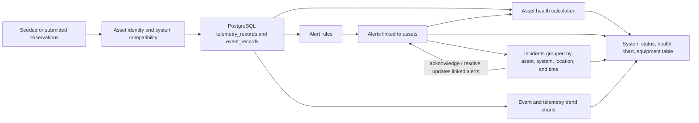

# Anzma AI Insight

Anzma AI Insight is a locally hosted smart-building operations demo. It brings telemetry and events from five building systems into one PostgreSQL database, detects operational problems, groups related alerts into incidents, and presents asset health and incident history in a dashboard.

The repository is a **simulated-data demo**, not a production building-management system. Dashboard/operational REST and Socket.IO routes require a deployment bearer secret; ingestion uses separate per-source keys. There is no direct live-device connection or equipment control. Recommendations are informational; the platform does not operate building equipment.

## What the platform does

1. Loads buildings, locations, systems, assets, metric and event catalogues, and synthetic history into PostgreSQL on the first start of an empty database volume.
2. Runs alert detection at startup and periodically afterward (default: every 60 seconds). Detection is idempotent: an existing alert is not inserted again.
3. Groups related alerts into incidents that operators can acknowledge or resolve.
4. Shows active alerts, incident history, asset health, system health, trends, and evidence in a browser dashboard.
5. Explains alerts with a local Ollama model when enabled. If the model is unavailable or its answer fails grounding checks, the platform can return a deterministic explanation based on stored evidence.

The application entry point, routes, startup tasks, and Socket.IO alert broadcast are in [`app/main.py`](app/main.py). Detection and persistence are coordinated by [`app/services/pipeline.py`](app/services/pipeline.py), [`app/domain/alerts/alert_engine.py`](app/domain/alerts/alert_engine.py), and [`app/adapters/database/db_adapter.py`](app/adapters/database/db_adapter.py).

## End-to-end workflow



The database stores telemetry and event observations separately. Both belong to an asset, and the reference catalogues validate that a metric or event type is compatible with that asset's system. The canonical schema and synthetic seed are in [`db/init/anzma_schema_and_seed.sql`](db/init/anzma_schema_and_seed.sql); Compose applies the incident, chat-view, and alert-uniqueness migrations from [`db/migrations/`](db/migrations/).

## Systems and their assets

The demo seeds 12 assets across five systems. Each system has its own compatible measurements and events; actual seeded metric coverage varies by system. A shared location alone does not make two different systems one incident.

| Dashboard system | Seeded assets | Example observations and fault/recovery events |
|---|---|---|
| **HVAC** | Air Handler 1, CRAC Unit 1, Chiller 1 | Temperature, humidity, and power telemetry; `hvac_fault` / `hvac_recovered`. CRAC Unit 1 is used in the cooling-failure scenario. |
| **Network** | Core Switch 1, Access Point Lobby, Annex Switch | CPU load, packet loss, and bandwidth utilization; `link_down` / `link_up`. |
| **Access control** | Main Door Reader, Server Room Reader | Door-forced, door-held-open, and access-denied events. The seeded catalogue has no generic close event for every access event, so incident resolution is the operator's acknowledgement that the related problem was handled. |
| **CCTV** | Lobby Camera, Control Room Camera | Camera FPS telemetry, camera offline/online events, and heartbeats. `camera_offline` / `camera_online` is a paired fault/recovery signal; silence and stale heartbeat data also affect health. |
| **Fire alarm** | Fire Panel Main, Smoke Detector Server Room | Smoke-level telemetry and `fire_alarm_triggered` / `alarm_cleared` events. |

The system catalogue, asset names, metric/event names, and compatibility rules are defined by the database seed. The dashboard translates database codes such as `NETWORKING` and `ACCESS_CONTROL` into the labels **Network** and **Access control** in [`app/api/frontend_api.py`](app/api/frontend_api.py).

### How alerts become incidents

- An **alert** is a detection by one rule on one asset. It has a severity (`info`, `warning`, or `critical`), evidence, and a lifecycle status.
- An **incident** is the operator-facing record that groups related alerts. The current grouping rule links alerts on the same asset, or on the same system type in the same location, when their time ranges overlap or are within 15 minutes.
- Alerts from different systems are not grouped just because they share a room. For example, a switch and a door reader in the same server room are not automatically treated as one incident.
- Incident severity is the highest severity among its linked alerts.
- The lifecycle is `open → acknowledged → resolved`; `resolved` is final. Acknowledge and Resolve update the incident and its linked alert records in the same transaction. The grouping and lifecycle rules are implemented in [`app/domain/incidents/incident_engine.py`](app/domain/incidents/incident_engine.py).

## Understanding dashboard status and charts

The dashboard has several views because event volume, asset condition, and incident workflow answer different questions. They share asset identities and refresh after an incident status change, but their numbers are not interchangeable.

### System status and System health chart

The system tiles summarize the health of the assets in each system. The stacked **System health (assets by status)** bar chart shows those same asset counts:

- **Green / OK:** assets currently classified as normal.
- **Amber / Warning:** assets with an active warning alert or warning fault, a recent unresolved warning event, or a data-freshness problem.
- **Red / Critical:** assets with an active critical alert or fault condition.
- **Gray / No data or Unknown:** assets with no recent reporting or no reporting history, when those categories are present.

The shared health rules are in [`app/repositories/dashboard_core_pg.py`](app/repositories/dashboard_core_pg.py). The per-asset equipment-health response applies the same alert and recovery relationships in [`app/api/frontend_api.py`](app/api/frontend_api.py).

Incident lifecycle affects health through the linked alerts. Open and acknowledged alerts contribute to the asset's Warning or Critical state. Resolving an incident resolves its linked alerts and retires matching fault observations covered by those alerts. A newer fault event can make the asset Warning or Critical again. Explicit recovery events, such as `camera_online` or `link_up`, also clear the corresponding paired fault state. No data and never-reported assets remain visible as separate health conditions; resolving an incident does not manufacture telemetry or a heartbeat.

The system tiles and health chart are refreshed from `GET /dashboard/overview`; the equipment table is refreshed from `GET /dashboard/equipment-health`. The overall tile is Critical if any asset is Critical, Warning when warning/no-data/unknown assets remain, and Operational when assets are healthy. If every asset is unknown, the tile is Unknown. The status aggregation and chart rendering are implemented in [`app/api/frontend_api.py`](app/api/frontend_api.py) and [`app/dashboard/static/dashboard.html`](app/dashboard/static/dashboard.html).

### Incidents by asset chart

The **Incidents by asset** stacked bar chart groups incident records by each affected asset:

- **Green:** resolved incidents (kept as history).
- **Amber:** active Warning incidents (`open` or `acknowledged`).
- **Red:** active Critical incidents (`open` or `acknowledged`).
- **Gray:** active Info incidents.

An incident connected to more than one asset through its alerts appears against each affected asset. The chart uses incident lifecycle and severity, while the System health chart shows the asset's operational state. This means the charts can legitimately differ: a resolved incident can move from an active incident segment to the green Resolved segment, while the asset remains Warning if it still has a newer fault or stale data.

Incident bars are returned as `incident_bars` by `GET /dashboard/overview` and are grouped in [`app/api/frontend_api.py`](app/api/frontend_api.py); the dashboard renders them in [`app/dashboard/static/dashboard.html`](app/dashboard/static/dashboard.html). The incident chart shows all stored incident history and is filtered by the selected system; it is not limited to the selected telemetry time window.

### Trend charts

| Chart | What it counts or measures | Source |
|---|---|---|
| **Events by system** (stacked bars) | Non-heartbeat events grouped into time buckets by system. | `event_records` |
| **HVAC average temperature** (line) | Average temperature by bucket. | Temperature telemetry |
| **Network bandwidth utilization** (line) | Average and peak utilization by bucket. | Bandwidth telemetry |
| **Denied access attempts** (bars) | Denied attempts by bucket. The seed does not store granted attempts, so no fake zero series is drawn. | `event_records` |

The trend endpoint is `GET /dashboard/trends`. Its bucket size adapts to the selected time window, and it excludes routine heartbeats from event counts. These charts use the time-window filter; the incidents-by-asset chart reflects incident lifecycle history instead.

### Filters, Alert Center, and refresh behavior

- The top system filter redraws the health chart for the selected system and filters the trend and incident-chart data. System status tiles continue to show all five systems so they remain available as filters.
- The time filter changes the fact-data window used by trend and health calculations. “Now” is anchored to the latest stored observation, not the computer clock.
- The Alert Center displays unresolved alerts and filters by severity and system. Resolved alerts leave the active list; their history remains available through Incidents.
- Clicking **Open incident #…** on an alert loads that incident's details, evidence, and status controls.
- After an operator acknowledges or resolves an incident, the dashboard reloads incidents, the Alert Center, system health, and charts. Socket.IO broadcasts newly detected alerts to connected dashboards; lifecycle changes are refreshed by the page that performed the action.

The page is [`app/dashboard/static/dashboard.html`](app/dashboard/static/dashboard.html), with Alert Center styles in [`app/dashboard/static/style.css`](app/dashboard/static/style.css). Dashboard responses are implemented by [`app/api/frontend_api.py`](app/api/frontend_api.py); Socket.IO and lifecycle routes are in [`app/main.py`](app/main.py).

### Why Alert Center and KPI counts can differ

The **Alert Center** lists detected alert records that are still open or acknowledged; resolved alerts are hidden from this active view. The **Alerts raised** and **Critical alerts** KPI cards count warning/critical rows in `event_records` within the selected time window. They are event counts, not counts of open Alert Center rows. The **Open incidents** KPI counts incidents whose lifecycle is not resolved across the database, regardless of the selected time window or system. These definitions come from [`app/api/frontend_api.py`](app/api/frontend_api.py) and [`app/repositories/dashboard_core_pg.py`](app/repositories/dashboard_core_pg.py).

## Run locally with Docker Compose

### Requirements

- **Demonstrated team setup:** the demo stack and `qwen2.5:3b` were running on a team laptop with 8 GB RAM. A user-provided `docker stats` snapshot showed a 3.76 GiB Docker memory limit and about 968 MiB across API, database, freshness, and Ollama containers at that instant (Ollama about 829 MiB). This is an observed working configuration, not a cross-laptop guaranteed minimum or an inference peak measurement.
- **Recommended for smoother use:** 64-bit Intel/AMD laptop, 4 CPU cores, 16 GB RAM, and 30 GB free disk space. CPU-core count and disk target are planning guidance, not measured requirements.
- Docker Desktop for Windows lists 8 GB system RAM as a WSL 2 hardware requirement. The team run demonstrates that this project can run at 8 GB on at least one laptop; performance and headroom will vary by machine and concurrent workload.
- Windows 11 64-bit with hardware virtualization enabled, current WSL 2, Docker Desktop, and Docker Compose v2. The one-command installer below is for Windows PowerShell. Docker Desktop's current Windows requirements include a 64-bit SLAT-capable processor, virtualization, and WSL 2 version 2.1.5 or later ([Docker Desktop requirements](https://docs.docker.com/desktop/setup/install/windows-install/)).
- First installation needs internet access to retrieve container images and the Qwen model. The configured `qwen2.5:3b` artifact is listed as about 1.9 GB by Ollama; allow additional disk for Docker images, build cache, and database growth ([Ollama Qwen2.5 model library](https://ollama.com/library/qwen2.5)).
- A local `.env` file with a non-empty PostgreSQL password and a unique API bearer secret; the installer can generate these when blank.
- The default host ports 5432 (PostgreSQL), 8000 (API), and 11434 (Ollama) must be available, or changed in `.env` before startup.

**GPU:** Not required by the current Compose configuration. The model can run through Ollama without a configured GPU, but response speed depends on the laptop and the GPU path has not been verified for this project. We have not measured peak RAM during model generation or Qwen response latency on the 8 GB laptop.

### One-command Windows demo install

From a PowerShell window at the repository root, run:

```powershell
powershell -NoProfile -ExecutionPolicy Bypass -File .\scripts\install_demo.ps1
```

The installer creates `.env` from the example only when `.env` does not exist. It fills blank PostgreSQL and dashboard secrets with random values, starts the Compose project `anzma-demo` with the dashboard and freshness worker, waits for `/ready`, and waits for the configured Ollama model pull to finish. It preserves existing `.env` settings and volumes. If a required port is already occupied, set `DB_HOST_PORT`, `API_HOST_PORT`, or `OLLAMA_HOST_PORT` in `.env` and rerun. To sign in, copy `ANZMA_API_TOKEN` from `.env` into the dashboard login prompt; keep `.env` private and out of source control.

For an isolated rehearsal, create a separate environment file with unused host ports and pass it with a unique Compose project name:

```powershell
$qaEnv = Join-Path $env:TEMP 'anzma-demo-qa.env'
$qaConfig = @('PGPASSWORD=', 'ANZMA_API_TOKEN=', 'DB_HOST_PORT=15441', 'API_HOST_PORT=18041', 'OLLAMA_HOST_PORT=11441', 'OLLAMA_MODEL=qwen2.5:3b')
[System.IO.File]::WriteAllLines($qaEnv, $qaConfig, [System.Text.UTF8Encoding]::new($false))
powershell -NoProfile -ExecutionPolicy Bypass -File .\scripts\install_demo.ps1 -ProjectName anzma-demo-qa -EnvironmentFile $qaEnv
```

The installer generates the blank secrets. The separate project uses separate database and model volumes; remove only those explicitly named QA resources after reviewing the evidence. Do not reuse production or active-demo project names when validating a clean installation.

This installs the synthetic demo dataset. It does not configure or claim a live building data source.

To inspect or stop this installation, use the same Compose project name:

```powershell
docker compose --env-file .env -p anzma-demo --profile freshness -f deploy/compose/docker-compose.yml ps
docker compose --env-file .env -p anzma-demo --profile freshness -f deploy/compose/docker-compose.yml logs --tail 100
docker compose --env-file .env -p anzma-demo --profile freshness -f deploy/compose/docker-compose.yml down
```

Do not add `-v` to the stop command; that removes the database and downloaded model volumes.

### Start

From the repository root:

```bash
cp deploy/examples/.env.example .env
# Set PGPASSWORD, then generate/store the API token without echoing it:
umask 077
ANZMA_API_TOKEN="$(openssl rand -hex 32)" python3 -c 'from pathlib import Path; import os; p=Path(".env"); p.write_text(p.read_text().replace("ANZMA_API_TOKEN=", "ANZMA_API_TOKEN=" + os.environ["ANZMA_API_TOKEN"], 1))'
# Change DB_HOST_PORT, API_HOST_PORT, or OLLAMA_HOST_PORT if needed.
docker compose --env-file .env -p anzma-insight -f deploy/compose/docker-compose.yml up -d --build
```

Open [http://localhost:8000](http://localhost:8000) for the dashboard. Enter the bearer token when prompted; it is exchanged for an eight-hour HttpOnly, SameSite=Strict cookie. API clients send `Authorization: Bearer $ANZMA_API_TOKEN`. `/health` and `/ready` are public for container checks; the static dashboard files are public, while data/control REST routes and Socket.IO require authentication. The explicit `--env-file .env` and `-p anzma-insight` ensure Compose reads the root configuration and targets the same project when you later rebuild a service.

Check service and dependency readiness:

```bash
docker compose --env-file .env -p anzma-insight -f deploy/compose/docker-compose.yml ps
docker compose --env-file .env -p anzma-insight -f deploy/compose/docker-compose.yml exec -T db pg_isready -U postgres -d anzma
curl -i http://localhost:8000/health
curl -i http://localhost:8000/ready
```

Expected bodies are `{"status":"ok"}` from `/health` and `{"status":"ready","database":"up"}` from `/ready`. The port variables in `.env` change host ports while container ports remain fixed. PostgreSQL and Ollama bind to `127.0.0.1` by default. Deliberate external access requires setting `DB_BIND_ADDRESS` or `OLLAMA_BIND_ADDRESS` to an appropriate address (for example `0.0.0.0`) and applying network controls; do not expose them to untrusted networks.

To rebuild only the API after changing application or dashboard files:

```bash
docker compose --env-file .env -p anzma-insight -f deploy/compose/docker-compose.yml up -d --build api
```

The PostgreSQL initialization scripts run only when the database volume is empty. Existing volumes are not reseeded automatically; apply migrations 006–011 to an existing database with the documented runner in [`docs/DATA_MIGRATION_PLAN.md`](docs/DATA_MIGRATION_PLAN.md). Migrations 009–011 add building schedules, freshness expectations and gap lifecycle, and source-liveness storage. Run the opt-in freshness evaluator with the `freshness` Compose profile; it is not started by the default command above. Avoid `down -v` for routine restarts: it deletes the local PostgreSQL data and downloaded Ollama models. Compose binds PostgreSQL and Ollama to loopback by default. Compose services and initialization mounts are defined in [`deploy/compose/docker-compose.yml`](deploy/compose/docker-compose.yml).

If Ollama or its model is unavailable, database-backed dashboard features continue to work and explanations can use the deterministic fallback. The AI runtime is optional for normal dashboard operation.

## Main API endpoints

| Endpoint | Purpose |
|---|---|
| `GET /dashboard/overview` | System status, KPIs, and incident-chart data. Accepts `hours` and `system_type`. |
| `GET /dashboard/trends` | Event and telemetry time series. Accepts `hours` and `system_type`. |
| `GET /dashboard/equipment-health` | Per-asset status and last-seen information. |
| `GET /alerts` | Alert Center records, including status and linked incident ID (bearer-authenticated). |
| `GET /incidents` | Ranked incidents and their linked alert IDs. |
| `GET /incidents/{id}` | Incident details and recommended actions. |
| `POST /incidents/{id}/status` | Acknowledge or resolve an incident and its linked alerts. |
| `GET /incidents/{id}/evidence` | Re-verified evidence for the incident. |
| `POST /alerts/{id}/explain` | Evidence-grounded explanation, with optional local model use. |
| `POST /api/v1/ingest/batches` | Authenticated, versioned batch ingestion for telemetry, events, and equipment state. |
| `GET /api/v1/ingest/batches/{batch_id}` | Retrieve batch outcomes and full rejected-record audit for the authenticated source. |

The v1 ingestion contract, response semantics, API-key lifecycle, and provisioning steps are in [`docs/INGESTION_CONTRACT.md`](docs/INGESTION_CONTRACT.md). Existing `POST /events` and `POST /alerts` routes remain supported.

## Repository map

| Path | Responsibility |
|---|---|
| [`app/main.py`](app/main.py) | FastAPI application, routes, startup detection, and live alert broadcast. |
| [`app/api/frontend_api.py`](app/api/frontend_api.py) | Dashboard, alert, trend, incident-chart, and equipment-health API responses. |
| [`app/domain/alerts/`](app/domain/alerts/) | Alert rules, thresholds, and detection behavior. |
| [`app/domain/incidents/incident_engine.py`](app/domain/incidents/incident_engine.py) | Alert grouping, incident lifecycle, and status propagation. |
| [`app/repositories/dashboard_core_pg.py`](app/repositories/dashboard_core_pg.py) | Shared asset-health and KPI calculations. |
| [`app/dashboard/static/`](app/dashboard/static/) | Dashboard HTML, CSS, JavaScript, and bundled chart library. |
| [`app/adapters/database/db_adapter.py`](app/adapters/database/db_adapter.py) | Shared database operations and idempotent alert storage. |
| [`db/init/`](db/init/) and [`db/migrations/`](db/migrations/) | Initial schema, synthetic data, and schema changes. |
| [`tests/`](tests/) | Unit, integration, and scenario checks. |
| [`deploy/compose/`](deploy/compose/) | Docker image and Compose services. |
| [`docs/`](docs/) | Run guide, data model, architecture, and project history. |

## Product direction and architecture

The CEO-confirmed product references and the broader target architecture are preserved in [`docs/product_reference/`](docs/product_reference/README.md). Start with the [executive architecture review](docs/CEO_ARCHITECTURE_REVIEW_BRIEF.md) for launch choices. Use [`docs/PROJECT_CHARTER.md`](docs/PROJECT_CHARTER.md) for the project north star, [`docs/WHOLE_SOLUTION_ARCHITECTURE.md`](docs/WHOLE_SOLUTION_ARCHITECTURE.md) for the proposed end-to-end solution, [`docs/DELIVERY_ROADMAP.md`](docs/DELIVERY_ROADMAP.md) for customer-gate sequencing, [`docs/G0_REPOSITORY_BASELINE.md`](docs/G0_REPOSITORY_BASELINE.md) for current source/worktree status, [`docs/BUSINESS_OUTCOMES_AND_SUCCESS_MEASURES.md`](docs/BUSINESS_OUTCOMES_AND_SUCCESS_MEASURES.md) for pilot success measurement, and [`docs/PRODUCT_REQUIREMENTS_TRACEABILITY.md`](docs/PRODUCT_REQUIREMENTS_TRACEABILITY.md) to compare that target with current implementation evidence. The [G1 working-slice static review](docs/v02/G1_STATIC_REVIEW.md) records implementation gaps and explicitly distinguishes source inspection from test evidence. The target documents describe intended product capabilities; they are not claims that the current simulated-data demo already delivers them.

## Project status and limitations

- The default dataset is synthetic and is loaded only when PostgreSQL initializes an empty volume.
- The demo uses a shared deployment bearer token for the operational dashboard/API and Socket.IO; ingestion has separate source-scoped keys. It does not directly connect to building devices.
- Incident resolution is an operator workflow state; linked alert records and covered fault observations are updated, but missing/stale data can still leave the asset in Warning.
- Recommendations are advisory. The application does not execute actions on HVAC, networking, access, CCTV, or fire-alarm equipment.
- Historical verification notes in `docs/` describe their recorded runs; they are not evidence that the current workspace or container has just been tested.
