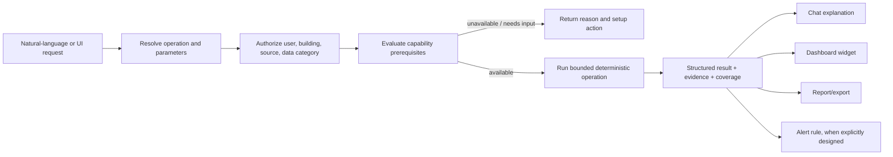

# Anzma AI Insight Analytics Capability Catalog

**Status:** Business and data design draft; analytic formulas require data-owner approval before implementation.  
**Companion:** [`WHOLE_SOLUTION_ARCHITECTURE.md`](WHOLE_SOLUTION_ARCHITECTURE.md)

This catalog translates the CEO's product examples into reusable operational analytic capabilities. The examples establish minimum proof cases; they do not limit the future product. No sample count or visual mockup value is a customer result.

## 1. Product rule

An analytic is a versioned, typed operation over authorized operational records. Chat is one way to request it; dashboards, reports and alerts reuse the same approved calculation and evidence contract. The assistant must not generate a new formula or unrestricted SQL to answer each question.

Keep these concepts separate:

- **Capability availability:** Can the configured sources provide the required data and permissions? `AVAILABLE`, `PARTIALLY_AVAILABLE`, or `UNAVAILABLE`, with an explanation.
- **Query coverage/completeness:** For this request and time window, can the system establish that the returned data covers the requested source/window? Coverage may be `UNKNOWN` even when the analytic is available.
- **Data freshness/quality:** Are the records valid and recent enough under the source/metric policy? Report the evaluation time and stale/missing/poor-quality conditions.
- **Result:** What deterministic calculation was applied to which scoped records, with evidence and limitations?

An empty result means no matching eligible records were found in the available stored data. It does not prove the upstream system had no such records if coverage is unknown or incomplete.

## 2. Candidate capability families

| Family | Business questions | Likely source families | First-release status |
|---|---|---|---|
| Source and asset health | Is the source connected? Which assets have stale or missing data? What data gaps need attention? | Connector diagnostics, BMS/VMS/IoT API, Core freshness records | Foundations exist for ingestion/freshness/source liveness; unified customer-facing connector health and coverage remain incomplete. |
| Alerts and incident operations | What needs attention? What happened? What evidence supports this alert? | Existing deterministic rules, events, telemetry, incident lifecycle | Existing demo foundation; needs product-level freshness/evidence and release verification. |
| Event counts and rankings | Which event/device/asset occurs most, by system, location or period? | Event history with stable IDs and approved event semantics | General pattern needed; two typed G1 examples are present in the worktree. |
| Security operations | Which doors physically opened after hours? Which access events occurred? | Door contact/open events, access decisions, building time zone | After-hours door opening is an engineering acceptance case; it must not treat `ACCESS_GRANTED` as physical opening. |
| Device availability | Which devices had the most outage episodes and for how long? | Explicit online/offline transitions or reliable state history | Offline frequency is an engineering acceptance case; repeated alarms need sessionization and silence cannot imply an outage. |
| Maintenance prioritization | Which equipment may merit inspection based on repeated faults, durations and trends? | Faults, telemetry/condition trends, maintenance history and asset context | CEO blueprint/v0.2 candidate; formula and label must avoid presenting a candidate as a diagnosis. |
| Energy and resource use | Is energy usage unusual for the load, time or comparable baseline? | Meter values, units, interval, occupancy/load or baseline | CEO blueprint example; requires unit/interval validation and baseline completeness before a result is ready. |
| Occupancy and performance | What is occupancy/utilization or operational throughput? | Occupancy counters, schedules and/or production data | Product family indicated by visuals; per-customer definitions and source evidence needed. |
| Personnel and attendance | Who may be late or where are access patterns unusual? | Verified attendance source, roster/schedules, holidays, identity mapping | Sensitive and not a default first-release capability. Access swipes alone do not prove attendance. Requires ADR-05 and identity/authorization approval. |

The architecture v0.2 scope names three deterministic analyses: after-hours doors, offline frequency and maintenance screening. The current G1 working slice covers the first two only. Maintenance screening is therefore a proposed next analytic, not an implemented feature.

## 3. Analytic definition contract

Each catalog entry must contain:

1. **Identity and ownership:** stable operation ID, semantic version, display name, business owner and data/implementation reviewer.
2. **Intent and scope:** supported questions, required filters, building/source/asset scope and authorization/data-category requirements.
3. **Prerequisites:** required sources, mappings, fields, units, event meanings, schedules, reporting intervals and minimum history.
4. **Time semantics:** UTC storage, local-time boundaries where needed, inclusive/exclusive rules, DST behavior and late/backfill treatment.
5. **Deterministic method:** approved formula/query behavior, tie-breaking, deduplication/sessionization, bounds, version and reproducible reference fixtures.
6. **Data validity:** accepted quality states, expected freshness, handling of invalid/missing/duplicate data and out-of-order events.
7. **Result schema:** stable typed columns, summary values, result ID, query parameters, generated/evaluated time, row count, truncation and pagination semantics.
8. **Evidence:** references to source records (source ID and external event/point ID where available), timestamp/value/unit, mapping identity and drill-down route.
9. **Coverage and limitations:** source synchronization state, history window/depth, missing pages, source retention, supported scope, assumptions, and honest `UNKNOWN` behavior.
10. **Delivery:** surface availability (chat/dashboard/report/alert), permissions, export policy and audit behavior.
11. **Acceptance tests:** positive, negative, boundary, timezone, duplicate, missing/late data, authorization, incomplete coverage, and cross-surface parity fixtures.

## 4. Initial analytic cards

These cards define minimum questions and required evidence, not the final formulas. Product/data owners must approve thresholds, schedules, ranking policy, and output wording before code claims business correctness.

### A. After-hours door openings

- **Example question:** Which doors opened after 20:00 during a selected date range?
- **Required evidence:** physical door-open/contact event, stable door identity and location, source event ID, source timestamp, building IANA time zone, selected local cutoff and dates.
- **Explicitly insufficient:** access-granted/denied by itself; no door contact data; unmapped door; unknown time zone; source coverage unknown presented as complete.
- **Current G1 evidence:** `door_opened` distinct from `access_granted`; building-local time and event references are part of the initial typed analysis. Chat currently requires two explicit ISO dates; natural-language range handling is incomplete.
- **Required tests:** time boundary; DST transition; midnight/date range; duplicate source event; unmapped event; incomplete history; access-granted-only source.

### B. Offline episode frequency

- **Example question:** Which devices were offline most frequently in a selected period?
- **Required evidence:** stable device identity plus explicit `offline_start` and `offline_end` transitions or an approved state history; time window; source synchronization and event deduplication.
- **Rule guard:** multiple starts during one open episode count once; a missing end leaves an open episode; silence alone never creates `offline_start`.
- **Required tests:** repeated starts, end before/inside window, outage beginning before window, missing recovery, duplicate/out-of-order events, ties, and unknown coverage.
- **Current G1 evidence:** explicit episode sessionization and evidence references exist in the unaccepted worktree slice; real vendor transitions are not yet demonstrated.

### C. Maintenance candidates

- **Example question:** Which assets should be reviewed for maintenance?
- **Required evidence candidates:** repeated fault events, fault duration, valid condition trends, asset criticality and optionally work-order/maintenance history.
- **Unresolved business decision:** approve a transparent score/rule, weighting, time horizon, tie behavior and minimum evidence. Until approved, return evidence-based candidates with contributing factors; do not claim a confirmed cause or predict failure.
- **Required tests:** one versus repeated fault, recovery, stale trend, missing maintenance records, criticality missing, source-specific data coverage, and evidence for every factor.
- **Status:** planned v0.2 analytic, not present in current G1 slice.

### D. Energy anomaly

- **Example question:** Is energy use unusual for the current operating context?
- **Required evidence:** meter identity, measurement type, unit, interval, quality, timezone/calendar, and an approved comparison baseline. Occupancy/load/production context may be required for normalization.
- **Unresolved business decision:** baseline period and comparability, seasonal/workday handling, minimum sample coverage, anomaly threshold, and whether normalization inputs are mandatory.
- **Required tests:** unit conversion, missing intervals, meter reset, seasonal shift, partial history, baseline drift, and insufficient coverage.
- **Status:** blueprint candidate; formula, prerequisites and implementation are open.

### E. Operational alerts and incident explanation

- **Example question:** What needs attention and what evidence explains the active alert?
- **Required evidence:** current alert/incident lifecycle, linked fact records, timestamps, asset/location context and data freshness.
- **Rule guard:** AI may summarize validated facts and limitations; deterministic alert state and operator lifecycle remain authoritative. For sensitive alerts, the next action should be selected by an approved deterministic playbook, not by the model; provisional actions must not appear as approved recommendations.
- **Required tests:** stale/missing evidence, recovered fault with unresolved alert, newer fault after recovery, contradictory records, model unavailable, and parity between dashboard and chat.
- **Status:** existing demo capability with documented guardrails; current explanation code still allows model selection among eligible actions, so the stronger deterministic-action policy is proposed pending ADR-11. Production user scoping and release qualification remain incomplete.

### F. Attendance or lateness

- **Example question:** Who arrived late most often?
- **Required evidence:** verified attendance source, person identity mapping, approved schedule, timezone, holidays/non-working periods, policy and per-user authorization.
- **Explicitly insufficient:** access swipe alone, assumed work hours, missing roster or identity, shared operator token.
- **Status:** restricted future candidate; unavailable until privacy and identity decisions are approved. The system should explain the missing prerequisites rather than infer a ranking.

## 5. Availability and result presentation

An analytic catalog endpoint/UI should expose a capability card with:

- `AVAILABLE`: all declared prerequisites and required permissions are configured; this does not guarantee complete coverage for every requested period.
- `PARTIALLY_AVAILABLE`: some valid scope/data exists, but named requirements or coverage are missing. Specify which buildings, sources, fields or dates are affected.
- `UNAVAILABLE`: a required input, permission, source capability or approved definition is absent; state the exact remediation.

Each execution returns a separate coverage state (for example `COMPLETE`, `PARTIAL`, `UNKNOWN`) and freshness/quality details. These status names need a versioned API contract. Do not overload a single `quality` field to mean both record quality and upstream completeness.

For each result, chat should show: the answer, selected time/building/source filters, result ID, calculation version, count/table, source and evidence drill-down, last data/sync time, coverage, and limitations. Dashboards and exports show the same parameters and caveats. Keep sensitive fields out of result rows unless the user's scope explicitly allows them.

## 6. Reusable execution path

The request resolver may use language models to map user wording to catalog operations and candidate parameters. The resolver must choose only registered operations; validate or ask about ambiguous parameters; enforce authorization before data access; and preserve the operation/version/parameters in the returned result. A future analytic is added by defining and reviewing its catalog entry, implementation and fixtures, not by growing a list of unrelated question-specific branches.

## 7. Catalog status in the current repository

| Area | Evidence today | Gap before product claim |
|---|---|---|
| Operational alert facts | Existing alert/evidence/dashboard/chat code and regression records | Current revision deployment and user-level scope need release evidence. |
| Ingestion facts | Versioned v1 contract supports source-scoped telemetry/event/state batches | A connector's discovery or source-history completeness is not automatically persisted by ingestion. |
| Freshness | Separate evaluator, gap/source-liveness state and read API are documented/implemented | Must be surfaced consistently with each analytic's coverage and freshness. |
| Typed analytics | Current worktree contains two typed operations | Not a generalized operation registry or robust natural-language parser; G1 is unaccepted. |
| Shared results | Structured response has evidence/limitations fields in current slice | No persisted result snapshot/checkpoint coverage contract; dashboard/report reuse is not complete. |
| KPI readiness | Required inputs can be modeled in this design | Customer-facing available/partial/unavailable catalog is proposed. |
| Authorization | Per-source ingest keys and shared operator auth exist | Fine-grained user/resource/data-category authorization is required before multi-user sensitive analytics. |

## 8. Ownership and review

For each analytic, name a business approver (meaning and operator value), data/analytics owner (formula, prerequisites, semantics and tests), platform owner (API, access, result lifecycle and UX integration), and QA reviewer (independent reconciliation evidence). Existing collaboration notes assign data semantics/evidence to Ahmed and platform integration/orchestration to Amr; confirm those owners against current team responsibilities before using this as a delivery RACI.

No formula or privacy policy in this catalog should be treated as approved merely because it appears in a mockup or is technically easy to implement.
