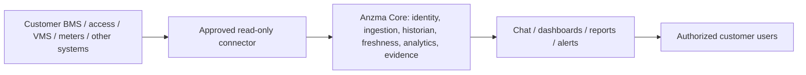

# Anzma AI Insight Executive Architecture Review

**Purpose:** Align on the business promise and first launch decisions before fixing the detailed architecture.  
**Status:** Discussion brief; recommendations below are not recorded as CEO decisions.  
**Date:** 26 November 2026

## The business solution

Anzma AI Insight is intended to sit alongside existing building systems and turn their authorized operational data into reliable answers and action context. A customer connects supported systems; Anzma discovers the actual data and capabilities; operators approve uncertain mappings; deterministic analytics produce results with evidence and coverage; chat, dashboards, reports and alerts present those same results. The original BMS, access-control and VMS systems remain responsible for their control functions.

The product should grow across building operations rather than being designed around two example questions. Each connector and analytic must state what it supports, what data it requires, and what it cannot prove.

## How the solution fits together

Core is installed once in the selected environment. Users access it in a browser. A connector may run near a building system when network segmentation requires it. Vendor-specific integration remains outside Core and uses the existing versioned ingestion contract. AI may interpret a question and explain a validated result; approved deterministic logic remains the source of the numbers.

## What exists and what is still a target

**Reusable foundation in the current repository:** PostgreSQL historian, per-source versioned ingestion, external asset mappings, freshness and source-liveness services, deterministic alerts/incidents, evidence-grounded chat, browser dashboard, Docker Compose demo and a reference simulator.

**Early uncommitted G1 slice:** synthetic paginated REST source, connector, and two typed operational analyses for after-hours door openings and explicit offline episodes. The repository's G1 status calls this an initial, unaccepted slice. It is not a real vendor integration and still lacks persisted analytic-result snapshots, complete synchronization/checkpoint evidence, a general analytics catalog, and successful browser visual verification.

**Not yet demonstrated as customer workflows:** setup wizard; source capability/device/point discovery; semantic mapping review; ready/partial/unavailable analytic catalog; broad catalog-driven chat; saved role-based dashboards; report generation; reconnect/replay alert stream; secure third-party embedding; production customer installation/upgrade; individual user authorization and production-qualified sizing/recovery.

This is why the current work should be presented as a strong platform foundation and prototype, not as delivery of the complete customer promise.

## Launch model options

| Option | What the customer gets | Main consequence |
|---|---|---|
| **Customer-managed on-prem/private cloud first** | Core once on customer server/VM, browser access, approved local connector | Best fit with the written install-once promise; customer IT and upgrade coordination are required. |
| **Anzma-hosted SaaS first** | Anzma operates Core; site connector sends authorized data outbound securely | Requires decided tenant isolation, residency, availability, incident response, support access, and recurring service operations before offer. |
| **Both at launch** | Both deployment models supported | Broadest market coverage but largest qualification, security, packaging and support burden. |

**Working recommendation:** customer-managed on-prem/private cloud for the first pilot, unless the target customer or commercial launch explicitly requires SaaS. This is not yet an approved decision. The supplied visuals conflict on on-prem, SaaS and per-PC installation; the written install-once/browser promise and visual brand should be reconciled before customer marketing.

## Workload and infrastructure proposal

These numbers help compare deployment options; they are **planning assumptions, not approved minimums or a purchase request**.

| Input | Working assumption | What still needs confirmation |
|---|---|---|
| Standard site | About 3,000 points, five-minute reporting, 90 days online (~77.76 million rows) | This row count assumes 3,000 total points for the site, not per building, and a reading from every point every interval. Confirm point scope, actual cadence, retention and database growth. |
| Scale unit | 2 buildings, 5 systems, 248 assets | The demo has five system types but only 12 seeded assets; 248 is a scale target. |
| Users | 10 concurrent users, 5 roles | The prototype uses a shared operator token; named identities and role enforcement are not verified. |
| AI | 7–8B Q4 model, Arabic and English, 2–4 concurrent responses | The Compose default is Qwen2.5:3b. Quality, latency, concurrency and peak memory need an Anzma benchmark. |
| Services | PostgreSQL 16, API/dashboard, optional freshness worker, Ollama, connector service | The main Compose stack has DB, API, Ollama/model setup and optional freshness. A production connector container is not wired into it. |
| Data boundary | Read-only; no video footage storage; CCTV events only | This is the intended boundary; event metadata still needs customer privacy review. Current demo data is synthetic. |

| Core RAM estimate | Planning range |
|---|---:|
| OS/Docker + PostgreSQL + API/freshness/reports + future connector + CPU inference | 22–36 GB before headroom |
| Add 30% headroom | 28.6–46.8 GB (about 32–48 GB planning band) |
| Proposed standard Core tier | 64 GB system RAM; validate under representative load |

**Scenario proposal:** S0 remains demo-only. S1 is the first live-site candidate at 16 cores / 64 GB / 2 TB NVMe; a 16–24 GB GPU is a candidate only if benchmarking supports it. S2 uses the same Core plus an OT-side gateway. S3 is a later private-cloud option. All performance, hardware and backup figures remain provisional. The supplied 20–60 second CPU and 3–8 second GPU answer times are unverified and must not be presented as service targets.

**Optional technology distinction:** GraphRAG would index approved documents and relationships to provide extra AI context; it can add indexing work and prompt tokens. Graphite would store platform-health metrics and use its own RAM/storage; it is not an AI model. Neither is in the current deployment or selected for launch. See ADR-12 and ADR-13 in the [decision register](ARCHITECTURE_DECISION_REGISTER.md).

## Decisions to make first

1. **Launch model and operator:** who owns install, upgrades, monitoring, backup and support?
2. **Pilot source:** which real customer/site and vendor system will replace the synthetic reference source? Who can supply documentation, a test endpoint and a read-only credential?
3. **Customer isolation:** one Core/database per customer for pilots, or a shared service? Do not offer multi-tenant SaaS until isolation is designed and tested.
4. **User identity and roles:** which customer identity provider and which building/system/data scopes? Shared operator token cannot support attributed roles or personnel analytics.
5. **First-release data policy:** building/equipment operations only, or personnel/attendance too? Keep person-level use unavailable until purpose, permissions, minimization, retention and audit are approved.
6. **Connector promise:** confirm certified self-service, configurable protocol/API, and custom integration support tiers.
7. **Analytics ownership:** name the business and data approvers for formulas, prerequisites, evidence, thresholds and golden fixtures.
8. **Service targets:** agree retention, alert latency, availability, backup destination, RPO/RTO and support window after pilot evidence.
9. **Local AI and optional extensions:** decide whether inference must stay on site; then size CPU/GPU/memory against measured model and concurrency needs. Decide separately whether GraphRAG knowledge retrieval or Graphite platform monitoring has a first-release business/operations need.
10. **Brand and claims:** approve the product name and correct visual statements that conflict with the selected deployment model.
11. **Sensitive-alert action policy:** confirm that an approved deterministic playbook selects one concise next action and the model only explains evidence. This reflects the user's earlier product preference; the current explainer still lets the model select eligible actions, and the CEO materials do not settle that authority question.

## Recommended first proof

Run one end-to-end pilot vertical slice against a real, approved source:

1. Install the chosen Core profile and sign in through the browser.
2. Test a connector with a real source and least-privilege read access.
3. Discover what it actually exposes; review device/point/event mappings.
4. Activate only an analytic whose prerequisites and permissions are met.
5. Reconcile the result to source records and show evidence, freshness and coverage.
6. Use the same structured result in chat and a dashboard; include a report once its service is implemented.
7. Interrupt and restore the source path, then prove the sync recovers without silent loss or invented facts.
8. Have an independent reviewer repeat the install and key acceptance cases.

The current synthetic G1 slice is useful rehearsal for this shape, but it does not satisfy the real-source pilot gate.

Connector claims should use the three tiers in the [whole-solution architecture](WHOLE_SOLUTION_ARCHITECTURE.md#customer-facing-connector-support-tiers). At present, the repository has synthetic reference tools but no real vendor connector qualified at any tier.

## Proposed decision meeting

| Topic | Decision needed | Why now |
|---|---|---|
| Deployment | Choose on-prem/private cloud, SaaS, or both for launch | Sets network, ownership, isolation, identity, and packaging architecture. |
| Pilot | Name site, source product/version, source contact and target date | Enables real device requirements, connector work, and measured sizing. |
| Customer promise | Confirm install-once/browser access, connector tiers and approved product name | Keeps diagrams, sales claims and delivery scope consistent. |
| Data/access | Confirm first-release data categories and identity/role expectations | Prevents privacy and authorization from becoming late rework. |
| Acceptance | Approve first analytics and evidence/reconciliation standards | Makes the demo a business proof rather than a synthetic UI walkthrough. |

## Supporting project records

- [Project charter](PROJECT_CHARTER.md) — persistent product north star and working rules.
- [Whole-solution architecture](WHOLE_SOLUTION_ARCHITECTURE.md) — functions, containers, workflows, deployment and source requirements.
- [Architecture decision register](ARCHITECTURE_DECISION_REGISTER.md) — options, recommendations, owners and open decisions.
- [Sensitive-alert AI authority decision (ADR-11)](ARCHITECTURE_DECISION_REGISTER.md#adr-11--sensitive-alert-recommendation-and-ai-authority) — separates the user's earlier preference from a CEO-approved product rule and records current code behavior.
- [Requirements traceability](PRODUCT_REQUIREMENTS_TRACEABILITY.md) — CEO requirements compared to current repository evidence.
- [Delivery roadmap](DELIVERY_ROADMAP.md) — CEO product gates distinguished from v0.2 engineering increments.
- [Business outcome measures](BUSINESS_OUTCOMES_AND_SUCCESS_MEASURES.md) — pilot scorecard and attribution rules without pre-judging ROI.
- [Analytics capability catalog](ANALYTICS_CAPABILITY_CATALOG.md) — data prerequisites, semantics and evidence for candidate analytics.
- [Pilot system qualification](PILOT_SYSTEM_QUALIFICATION_TEMPLATE.md) — customer/vendor intake and sizing evidence.
- [Preserved CEO references](product_reference/README.md) — exact copies of the three blueprints and four supplied visuals.
