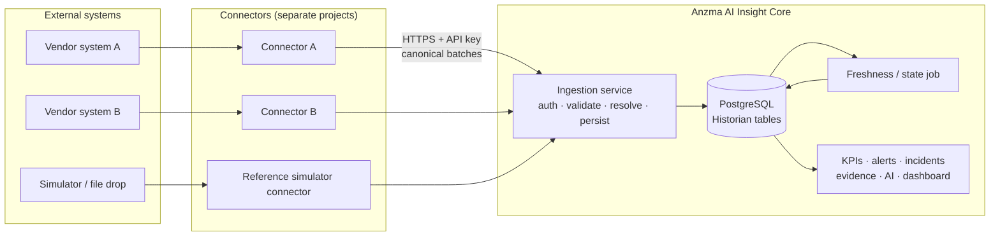
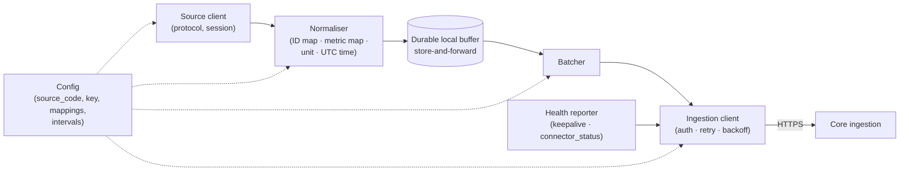
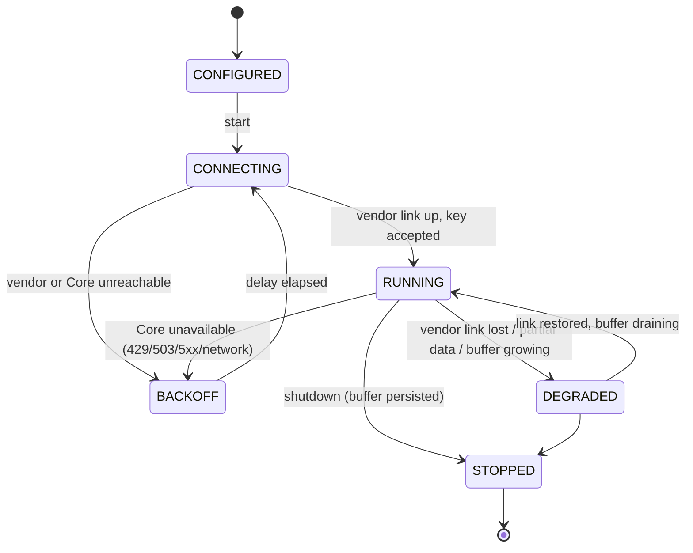

# CONNECTOR_ARCHITECTURE.md — Anzma AI Insight Core

**Status:** Core v1 ingestion and a reference simulator are implemented. This document describes the connector boundary; **no real vendor/device system is connected yet.**
**Scope:** the general architecture every connector follows. Vendor-specific protocol integration and vendor SDKs remain future work.
**Normative wire format:** [`INGESTION_CONTRACT.md`](INGESTION_CONTRACT.md). **Storage:** [`CONTRACT_TO_DB_MAPPING.md`](CONTRACT_TO_DB_MAPPING.md). **Entity semantics:** [`CANONICAL_DATA_MODEL.md`](CANONICAL_DATA_MODEL.md). **Historian:** [`HISTORIAN_DESIGN.md`](HISTORIAN_DESIGN.md).

Tags: **[Decided]**, **[Proposed]**, **[Open]**, **[Verified]** (checked in the repository).

---

## 1. Purpose and non-goals

**Purpose.** Let any external system (BMS, VMS, PSIM, a vendor SDK, a protocol gateway, a file drop, a simulator) deliver data to the Core in exactly one way, so that adding a vendor never requires a Core code change or a Core data-model change.

**Current limits**

* No real vendor-specific connector, including the Milestone plugin (a separate project per the product plan).
* No equipment control and no write-back to external systems.
* No message broker. PostgreSQL stays the only store (`HISTORIAN_DESIGN.md`, AD-01).

## 1.1 Current proof and limits (22 November 2026)

The reference simulator exercises the ingestion path, but its sample IDs and readings are demo data. The verified Main Tower setup registered source `reference-simulator-main-tower` for building `MAIN-TOWER-DEMO` and mapped nine external IDs to existing Main Tower seed assets. Those IDs use the `seed:` prefix; they are **not IDs from a real vendor**. A normal simulated batch accepted 4,154 records with no rejections. During the check, source liveness was `ALIVE` inside its grace window while `vendor_link` remained `UNKNOWN`.

The simulator sends a batch and then keepalives; it does not continuously receive sensor telemetry. No external BMS, device, or vendor was connected in this verification.

For a real integration, the path is:

1. A vendor connector reads the external system and translates its names, units, timestamps, and device IDs into the canonical ingestion contract.
2. The connector posts the batch to `POST /api/v1/ingest/batches` using that source's credential and external IDs.
3. Core validates the source/building scope and resolves each external ID through the mapping table to an existing Core asset. An unresolved external ID is rejected; it does not create an asset or expose a Core ID to the vendor.
4. Core persists accepted observations and provenance. Freshness evaluation and alert/incident detection run through their Core paths; the ingestion call itself does not create a chatbot recommendation.
5. The dashboard displays stored operational information. An operator can ask the assistant to explain an incident and recommend actions using available evidence. This is an operator interaction, not an automatic response to every incoming signal.

Reported-state records can be stored, but they are not currently consumed by alert/incident rules. See [`INGESTION_CONTRACT.md`](INGESTION_CONTRACT.md) for the wire contract and [`DAY3_DEPLOYMENT_VERIFICATION.md`](DAY3_DEPLOYMENT_VERIFICATION.md) for install/runtime evidence.

---

## 2. Where connectors sit

Connectors are **independent projects** that talk to the Core only over the ingestion HTTP interface. They may be written in any language and deployed separately.



The only coupling point is the contract. The Core never calls a vendor system, and a connector never touches the Core database.

---

## 3. Responsibilities

### 3.1 What a connector does

| # | Responsibility | Detail |
|---|---|---|
| 1 | Connect and read | Own the vendor protocol, session, credentials and polling or subscription. |
| 2 | Receive telemetry, events and states | Read measurements, discrete events and equipment state reports. |
| 3 | Translate to the canonical form | Vendor payload → contract records (`INGESTION_CONTRACT.md` §5). |
| 4 | Normalise names, metrics and units | Vendor point names → `metric_code`; vendor units → the metric's canonical unit. Conversion happens **here**, not in the Core. |
| 5 | Normalise time | Convert every timestamp to UTC with `Z`. Keep the original in `source_metadata`. |
| 6 | Identify external devices | Send the vendor's stable device ID as `external_id`. Never invent or reuse IDs. |
| 7 | Deliver through the one interface | Batches of records through `POST /api/v1/ingest/batches`, continuous or batched. |
| 8 | Handle failures | Classify responses, retry safely with the same `batch_id`, buffer while the Core is unreachable (§6). |
| 9 | Declare its identity | Present `source_code`, connector name and version on every batch. |
| 10 | Report its own health | Optional `connector_status` (vendor link state, buffered and dropped counts) and keepalive batches. |

### 3.2 What the Core does

| Responsibility | Where |
|---|---|
| Authenticate the source, enforce scopes | Ingestion service |
| Validate every record, resolve identities, check system compatibility | Ingestion service |
| Persist idempotently, stamp `received_at`, log rejections | Ingestion service / Historian |
| Compute freshness, communication status, state, gaps | Freshness/state job |
| KPIs, alerts, incidents, evidence, AI, dashboards | Operational intelligence (existing) |

### 3.3 Boundary rules

A connector **must not**:

* write to the Core database or call internal Core functions;
* use Core internal IDs (`asset_id`, `metric_id`);
* compute KPIs, alerts, incidents or severity of its own;
* send `communication_status`, `freshness` or `operational_state` (Core-derived);
* infer or send `UNAVAILABLE`/`OFFLINE` merely because a device went silent;
* send local-time or offset timestamps;
* invent measurements to fill gaps, or silently drop data without reporting `dropped_records`.

The Core **must not**:

* contain vendor-specific parsing, mapping or branching on manufacturer;
* require a data-model change per vendor;
* accept data that did not come through the ingestion interface (the seed and `POST /events` are legacy paths with source `legacy-seed`, retired as simulators move to the connector path).

---

## 4. Reference connector internals

Not mandatory for implementers, but every connector should provide these concerns, ideally as separate modules.



| Module | Duty |
|---|---|
| Source client | Vendor session, polling or subscription, reconnect. Knows nothing about Anzma. |
| Normaliser | The only place vendor knowledge meets canonical names: ID mapping table, metric mapping, unit conversion, UTC conversion. Deterministic: the same raw input always yields the same record, including `observed_at` and `source_event_id`. |
| Durable buffer | Survives connector restarts (disk-backed queue or embedded database). Holds normalised records, not raw vendor payloads. |
| Batcher | Groups records (target 500–1000, hard cap 5000) and **assigns `batch_id` once**, persisting it with the batch so a restart resends the same ID and payload. |
| Ingestion client | HTTPS, API key, response classification, retry. |
| Health reporter | Sends `connector_status` and, when idle, empty keepalive batches. |
| Config | `source_code`, key, device and metric mappings, polling intervals. Per-customer differences live here, never in the Core. |

---

## 5. Lifecycle

### 5.1 Connector states



### 5.2 Acquisition styles

All three emit the same canonical records; they differ only in how data reaches the connector.

| Style | When | Connector behaviour |
|---|---|---|
| **Polling** | Vendor exposes a read API | Read each point on its interval; keep a cursor of the last observed time to avoid gaps and repeats. |
| **Push / subscription** | Vendor emits events or streams | Accept callbacks or subscribe; acknowledge the vendor only after the records are in the durable buffer. |
| **Bulk / file import** | Historical or periodic exports | Parse, normalise, send as `delivery_mode: BACKFILL`. |

### 5.3 Delivery flow

```mermaid
sequenceDiagram
    participant V as Vendor system
    participant C as Connector
    participant K as Core ingestion
    participant D as PostgreSQL
    V->>C: raw reading / event / state
    C->>C: normalise (IDs, metric, unit, UTC)
    C->>C: append to durable buffer, form batch, fix batch_id
    C->>K: POST /api/v1/ingest/batches (API key)
    K->>K: authenticate, validate envelope
    K->>K: per record: resolve · check · classify
    K->>D: one transaction: records + batch row + rejections
    K-->>C: 200 ACCEPTED / PARTIAL (counts, rejected[])
    C->>C: drop batch from buffer; keep rejected for review
    Note over C,K: on 429/503/5xx/network error: resend the same batch_id after backoff
```

### 5.4 Continuous or batched

Both are supported and are the same call. A connector with a stream sends small, frequent batches (even one record); a connector with a periodic export sends large ones. Core-side behaviour does not depend on batch size.

---

## 6. Errors, retry and store-and-forward

**Rule: retry only what is retryable, always with the same `batch_id` and the same payload.** Response classes are in `INGESTION_CONTRACT.md` §10.2 and §12.5.

| Situation | Connector behaviour |
|---|---|
| `429`, `503`, `500`, timeout, connection refused | Retry the batch unchanged. Exponential backoff with jitter (start 1 s, double, cap 5 min **[Proposed]**). Honour `Retry-After`. |
| `4xx` batch-level | Stop retrying that batch; raise an operator-visible error. Do not discard silently. |
| `200 PARTIAL` | Batch is done. Persist the `rejected[]` entries for review; they are only resent after being fixed, in a **new** batch. |
| `409 BATCH_ID_REUSED` | A bug: the same ID carried a different payload. Log and alert; never "fix" by reusing the ID. |
| Vendor link lost | State `DEGRADED`, keep running, send `connector_status.vendor_link = DISCONNECTED`. **Do not synthesise** zero values or offline events. |

**Store-and-forward.** The connector buffers while the Core is unreachable and drains in order of observation once it returns, as `delivery_mode: BACKFILL` when the data is old. The Core copes because ingestion is idempotent and ordering-independent.

**Buffer limits.** When the buffer reaches its configured cap, the connector must apply an explicit policy (default: drop oldest) and **report the loss** through `connector_status.dropped_records` so the Core can show a known data gap instead of an unexplained silence. **[Proposed]**

**Back-pressure.** `429` and `503` are the Core's way to slow a connector. The Core's detection loop must not be starved by ingestion load (`HISTORIAN_DESIGN.md` §11).

---

## 7. Identity

| Level | Identifier | Owned by | Notes |
|---|---|---|---|
| Source | `source_code` | Core registry (`data_sources`) | One per connector instance per building. Bound to the API key. |
| Building | `building_code` | Core registry | One batch → one building. |
| External device | `external_id` | The vendor | Unique within the source. Must be stable across reconnects and restarts. |
| Internal asset | `asset_code` / `asset_id` | Core | `asset_id` never leaves the Core. |

**Mapping.** `asset_external_ids (source_id, external_id) → asset_id` is the single place where a vendor device meets an Anzma asset. Mapping is configuration performed by an administrator (API or file import), not code.

**Provisioning flow [Proposed]**

1. An administrator registers a source (`source_code`, building, key). 
2. Assets exist in the Core (already the case for current data).
3. The administrator maps `external_id → asset_code` for the source. 
4. The connector starts sending. Records for unmapped devices are rejected `ASSET_UNRESOLVED` and surface in the "unmapped external IDs" list.
5. The administrator maps them; the connector resends in a new batch.

**Not allowed:** automatic asset creation from incoming data in v1, and a connector choosing an `asset_code` that belongs to another building.

**Rename-safe.** A vendor renaming a device display name changes nothing as long as its `external_id` is stable. If the vendor changes the ID itself, that is a mapping change, never a code change.

---

## 8. Security

| Aspect | Rule |
|---|---|
| Authentication | API key per source with scopes, bound to one source/building (`INGESTION_CONTRACT.md` §11). **[Decided to start; final model Open]** |
| Transport | TLS required outside local development. |
| Secrets in connectors | Keys live in configuration/secret storage, never in code or logs. |
| Least privilege | A key may only write the record types in its scopes, only for its own building. |
| Rotation | Two active keys per source allow replacement without downtime. |
| Auditability | Each batch records source, connector name/version, key prefix, and result. |

---

## 9. Observability

**Connector side:** structured logs of every batch (ID, record count, response status, retry count), buffer depth, drop counters, vendor link state.
**Core side:** `data_sources.last_success_at / last_error_at / status`; `ingestion_batches` counts; `ingestion_rejections` by `reason_code`; per-source latency (`received_at − observed_at`).

**Health signals the Core derives**

* Source keepalive overdue ⇒ source `STALE`, then `LOST`.
* Many assets of one source stale together ⇒ attribute to the source, not to each device.
* Rejection rate above a threshold (default 20 % over 10 batches **[Proposed]**) ⇒ source `DEGRADED`, which usually indicates a mapping or unit bug in the connector.

---

## 10. Conformance checklist for a new connector

A connector may be called ready when it:

1. Passes the conformance vectors in `INGESTION_CONTRACT.md` §13.3 against a Core test instance.
2. Produces byte-identical records for identical raw input (determinism), including `source_event_id` and `observed_at`.
3. Persists `batch_id` with its batch across restarts.
4. Demonstrates a Core outage: buffering, backoff, and a clean drain with no duplicates stored.
5. Demonstrates a vendor outage: `DEGRADED`, no fabricated data, no `OFFLINE` inferred from silence.
6. Converts units and time zones correctly (documented test cases, including a DST change).
7. Sends no Core-derived fields and no internal IDs.
8. Keeps all customer-specific configuration outside the code.

**Implemented reference:** the repository includes a simulator connector that sends synthetic readings through the real contract. It demonstrates the Core ingestion boundary, but it does not replace a real vendor integration or prove live sensor connectivity. The next real integration still needs a selected vendor/protocol, its payload or documentation, and an external-ID/metric mapping.

---

## 11. Decisions and open points

| ID | Item | Status |
|---|---|---|
| D1 | `MISSING` is not a quality value; missing data is detected separately | Decided |
| D2 | Connector reports known state; Core computes freshness; no `OFFLINE` from silence | Decided |
| D3 | First write wins on conflicting duplicates | Decided |
| D4 | Partial acceptance within a batch | Decided |
| D5 | API key per source to start; final model open | Decided / Open |
| C1 | Connector-reported `connector_status` and keepalive batches | Proposed |
| C2 | Buffer-overflow policy and `dropped_records` reporting | Proposed |
| C3 | Retry backoff parameters (1 s → 5 min, jitter) | Proposed |
| C4 | Source `DEGRADED` threshold (20 % rejected over 10 batches) | Proposed |
| C5 | Admin API vs file import for source registration and mappings | Open |
| C6 | Core-side asset discovery (connector lists devices for approval) | Future |
| C7 | Connector SDK or shared client library (Python reference) | Future |
