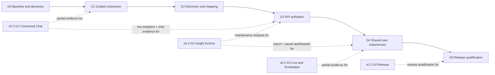

# Anzma AI Insight Delivery Roadmap

**Status:** Dependency-based roadmap for discussion as of 26 November 2026; no delivery dates or customer commitments are approved.  
**Authority:** CEO product gates from the self-service blueprint; technical scope and acceptance proposals from `Anzma_AI_Insight_v0_2_Engineering_Architecture.md`; current implementation status checked against the working tree. The engineering architecture is marked **PROPOSED for CEO approval**. This roadmap uses it to plan traceable work, but does not record its proposed product choices as CEO-approved decisions.

## Agreed execution order (26 November 2026)

The project owner approved this dependency order for continued work. This approval is for the team's working sequence; it does not stand in for CEO decisions about deployment, pilot source, data policy, product claims, formulas, or commercial support.

1. **G0 — Protect and baseline.** Keep the existing worktree intact. Inventory the current implementation and uncommitted changes; reconcile the implementation with the approved API/data contracts and owner boundaries; record environment and verification limitations. No reset, cleanup, commit, push, or migration against a shared database is implied.
2. **G1 — Guided connection and connected-chat vertical slice.** Review and harden the SDK/reference connector and ingestion path, then demonstrate a separately running reference API through connector, Core, two approved typed analyses, and cited chat. Deliver the customer-facing guided connection only to the level supported by the selected launch profile and pilot source. Synthetic proof is engineering evidence, not real-vendor qualification.
3. **G2 — Discovery and semantic mapping.** Add capability-aware asset/point/event discovery, guided mapping proposals and human approval. This connects the architecture's connector manifest to the CEO blueprint's discovery/mapping gate.
4. **G3 — KPI activation and reliable AI.** Add the third mandatory maintenance screening analysis, catalog prerequisites/readiness, authorized typed query routing, evidence/coverage/freshness, and retained result snapshots. Personnel attendance remains explicitly blocked without approved identity, roster/schedule and privacy controls.
5. **G4 — Shared experiences, reports, dashboards, live alerts and embed.** Make chat, report, saved dashboards and alerts consume the same authorized results; deliver one report, two saved/editable dashboards, event-ID replay/reconnect, and the documented secure embedded chat host.
6. **G5 — Release and handover.** Complete the architecture's release increment: clean install on a second environment, regression/security/performance/recovery checks, independent QA, reviewable demo, immutable release tag, limitations and support documentation.

**Amr ownership boundary:** connector SDK and external REST integration, application API and orchestration, AI tool routing and conversational UI, dashboard/report integration, embedded chat, and live alert delivery. Coordinate canonical data semantics and formulas with their owner; do not self-certify independent QA. The current role-based HTML is a design reference, the existing application dashboard is an implementation asset, and the CEO materials define the target promise. Prototype-only behavior or illustrative values must not be represented as working product behavior.

**Scope guardrails:** make additive, reviewable changes; preserve existing work; avoid vendor-specific branches in Core; state supported/unsupported capability honestly; and do not claim a customer gate passed without its named acceptance evidence. Keep proposed decisions distinct from approved decisions and verified implementation.

This roadmap separates customer/product acceptance from engineering increments. A lower-level technical demonstration may contribute evidence to a product gate without satisfying the entire customer-facing requirement.

**Parallel-work rule:** bounded, isolated G1 engineering may proceed while G0 decisions and acceptance evidence are being closed. Do not run changes against shared/live data, represent G0 as accepted, qualify a customer pilot, or freeze/push a release until the remaining approvals and immutable-candidate review are complete.

## 1. Gate map

| Gate | Status at 26 Nov 2026 | Goal / customer evidence | Work packages | Dependencies and decision gates | Exit evidence |
|---|---|---|---|---|---|
| **G0 — Baseline and decisions** | **Verification complete 26 Nov; gate not passed — worktree preserved and checks recorded, with product/data-owner approvals still open.** | Team can state what exists, what is promised, how a change is proven, and what a successful pilot means. | Inventory current routes/data/contracts/deploy; preserve working changes; establish reproducible baseline; approve semantics, first-slice scope and pilot measurement plan; document supported vs proposed claims. | ADR-01 launch deployment model and ADR-02 pilot source; agree owners for source semantics, analytics, customer outcomes and baseline measures. | Named immutable baseline; clean or explicitly recorded worktree; versioned API examples; golden fixtures and baseline outputs; current-vs-target traceability and pilot scorecard reviewed. See [`G0_REPOSITORY_BASELINE.md`](G0_REPOSITORY_BASELINE.md) and [`BUSINESS_OUTCOMES_AND_SUCCESS_MEASURES.md`](BUSINESS_OUTCOMES_AND_SUCCESS_MEASURES.md). |
| **G1 — Guided connection + Connected Chat vertical slice** | **Synthetic reference engineering path verified 26 Nov; CEO gate not accepted.** The disposable full path accepted 8/8 fixture events, guided connection checks passed, G1 chat/API checks passed 3/3, and checkpoint lost-response replay passed 1/1. The setup route also passed auth, invalid-credential, origin-denial, and secret-redaction smoke checks. | Customer can connect/test a separately running reference API in a guided flow; the engineering demonstration proves read-only source → connector → Core ingestion → deterministic analysis → cited chat. | Review common SDK/manifest and Core contract 1.0; authentication, pagination, rate-limit/transient errors, timeout and incomplete-page behavior; stable ID/deduplication; durable restart/replay; initial onboarding/test-connection flow; after-hours door and offline-frequency tools routed through bounded chat. | ADR-01 deployment/operator; ADR-02 first pilot/reference source; ADR-06 support tiers; source/data owner review of event meanings; real-source access for vendor qualification. | A01, A02, A08 and A09; independent reference service; exact fixture evidence; sanitized failures; complete-vs-incomplete history honest end-to-end; idempotent batch retry and restart recovery; customer-like connection flow without code/SQL edits. Synthetic acceptance supports only the reference contract, not a certified real vendor. |
| **G2 — Discovery and semantic mapping** | **No acceptance evidence found.** | Customer sees actual source capabilities/data and reviews uncertain or unavailable items before mapping approval. | Capability manifest/registry; asset, point and event discovery; hierarchy/import; rule-first mapping suggestions with evidence/confidence; explicit human approval/history; unsupported, empty and unmapped items visible; limited and feature-rich source paths. | G1 connector lifecycle/discovery contracts; a real source endpoint for qualification; mapping steward and data/privacy scope. | Inventories reconcile to source; unsupported differs from empty; correct/wrong/uncertain mapping cases pass; approvals/audit persist; no semantic mapping silently accepted. |
| **G3 — KPI activation + Insight Actions** | **Partially evidenced by two synthetic typed analyses; CEO gate not passed.** | Customer activates only supported, authorized metrics and receives deterministic, cited results whose completeness and freshness are clear. | Third mandatory tool `maintenance.candidates` with visible approved formula; analytics catalog/prerequisites and ready/needs-input/unavailable states; typed query authorization/bounds/tracing; quality/freshness/coverage separated; natural-language routing to approved tools; evidence/result envelope and retained `result_id` snapshots. Attendance remains blocked absent authorized identity, roster, schedule, policy and fixtures. | G2 approved mappings; data/privacy categories; named formula approver; identity/scope policy; snapshot retention decision. | A01–A04 and A09–A10 as applicable; three deterministic tools reconciled against source records; timezone/DST, duplicates, flapping, missing/partial history and permission cases; exact evidence and explicit unknown/blocked state; same result ID reusable downstream. |
| **G4 — Shared experiences + Live and Embedded** | **No acceptance evidence found for the architecture's full v0.2 experience scope.** | One authorized result stays consistent across chat, reports, saved dashboards and alert investigation; embedded chat works only on an approved host origin. | Generate one HTML/PDF report plus CSV from a result snapshot; create/save/edit at least two dashboards from approved widget specs; migrate UI incrementally (keep legacy dashboard until parity; React/TS is a proposed architecture choice); event-ID alert stream with initial load, replay/backfill, dedupe and reconnect; embedded chat with origin allowlist and safe auth; shared result/evidence drill-down. | G3 stable result contract; role/building/system/data-category controls; retention/export and embed-origin decisions; sensitive-action policy approval. | A05–A07 and A10; report figures/filters/coverage/evidence equal the source result; dashboards persist/reload and obey scope; alert reconnect has no loss or duplicate display within defined retention; embed rejects unapproved origins and leaks no token; no unsupported live/real-time claim. |
| **G5 — Release qualification** | **No customer-production acceptance evidence found.** | Customer IT and independent QA can install, operate, recover and validate an immutable release. | Supported deployment profile; TLS/identity; upgrade/rollback; monitoring/log redaction; backup/restore; capacity and failure testing; source disconnect/replay; security/privacy checks; docs/support handoff. | ADR-01/03/04/05/08/09; chosen pilot source and hosting profile; all prior gates. | Fresh install and upgrade on second environment; restore drill; representative load and hardware tier; reconnect/backfill with no silent loss; no P0/P1 defects; independent pass, demo/video, release tag and support runbook. |

## 2. Engineering-increment to CEO-gate crosswalk

The architecture defines four proposed engineering increments; the CEO blueprint defines customer/product gates. The increments provide implementation slices and evidence. They do not rename, replace, or automatically pass the CEO gates.

| Proposed v0.2 engineering increment | Main deliverables from the architecture | CEO gate(s) supported | Amr / partner ownership |
|---|---|---|---|
| **v0.2 G1 — Connected Chat** | Separate authenticated REST reference API; connector SDK and Core ingest 1.0; two deterministic analyses; cited chat/table; paging/error/negative cases. | **G1** connection/integration proof and **G3** initial analytics evidence. | Amr leads SDK, connector, API/chat integration; Ahmed owns canonical semantics and analysis correctness; independent QA verifies acceptance. |
| **v0.2 G2 — Insight Actions** | Third maintenance-screening analytic; one report from a result; result reuse; two saved/editable dashboards. | **G3** KPI activation and **G4** shared result/report/dashboard experience. | Amr leads report/dashboard services and UI; Ahmed owns analytic formula and golden fixtures; joint query/result contract review. |
| **v0.2 G3 — Live and Embedded** | Event IDs, live alert push, replay/backfill/reconnect; secure embedded chat host. | **G4** shared experiences and alert investigation. | Amr leads alert stream/embed; security and product owners approve auth/origin behavior; independent QA runs disconnect/recovery cases. |
| **v0.2 G4 — Release** | Fresh install, regression, performance/security/recovery checks, demo, documentation and release evidence. | **G5** release qualification and handover. | Amr owns packaging/demo/handover contributions; platform/data owners review their areas; independent QA signs off. |

The architecture requests weekly increments, but this roadmap assigns **no dates or one-day completion promise** until dependencies, access, owners and capacity are known. CEO approval is still required for its proposed scope and decisions such as the React/TypeScript console choice, identity policy, retention/latency targets and deployment promise.

## 3. Current work placement

The uncommitted v0.2 G1 slice includes a synthetic, separately hosted REST event source; cursor-paginated connector; translation through ingestion contract 1.0; explicit door/offline event semantics; two typed analytics; early chat routing; and focused tests. Its own `docs/v02/G1_FIRST_SLICE.md` records that it is **not an accepted milestone**. It also records important limits: external IDs need prior mappings; result snapshots and source sync checkpoints are absent; coverage remains unknown; chat accepts only two explicit ISO dates; and browser visual behavior was not verified.

**Current G1 engineering work (26 November 2026):** the reference adapter now requires an explicit boolean completeness field on every page. It also uses a local SQLite outbox/checkpoint: the exact Core batch is saved before submission, the source cursor advances only after full Core acceptance, and a lost response replays the same batch ID and payload. Completed ranges are skipped on rerun; incomplete ranges restart from the beginning and depend on Core's idempotent event IDs. Each accepted ingestion batch records its upstream page-completeness signals in Core's connector diagnostics, while the overall range is reported `INCOMPLETE` if any page is incomplete. The focused reference REST/analytics unit module passes **19/19**, including restart-after-lost-response, completed-range skip, incomplete-coverage, and concurrent-run rejection cases, in a network-isolated, resource-limited container with the worktree mounted read-only. This remains synthetic connector evidence, not a real-vendor qualification or CEO G1 pass. The runner requires a persistent local state volume and source cursors that survive restart; Core does not yet retain or expose range-level sync completeness. Real-source qualification still depends on an approved pilot source and access.

Therefore:

- It contributes a technical precursor to CEO G1 (independent HTTP integration), but lacks the guided customer setup.
- It contributes analytic proof cases to CEO G3, but lacks the general capability registry, customer readiness catalog and complete coverage contract.
- Its successful synthetic fixture checks do not prove real vendor compatibility or production release qualification.
- Do not discard or rebase these uncommitted changes as part of roadmap planning; review and reconcile them against the current baseline before accepting the slice.

## 4. Cross-cutting workstreams

These run through multiple gates and must not be deferred to release week:

- **Product and customer success:** supported integration tiers, user research, onboarding copy, actual customer validation, clear limitations.
- **Data intelligence:** canonical entities, event semantics, units, quality, freshness, formulas, coverage, evidence and golden fixtures.
- **Security and privacy:** customer/user/connector identities; scoped authorization; secrets; audit; personnel data policy; export controls.
- **Platform engineering:** versioned APIs, connector runtime, migrations, observability, failure/recovery and backward compatibility.
- **User experience:** browser setup, role workflows, accessible status/limitations, saved layouts and report presentation.
- **Operations:** packaging, installation, upgrade, backup/restore, support ownership, performance and capacity.
- **Independent QA:** customer-like environment, positive and negative testing, release evidence and no self-certification.

## 5. Ownership proposal

The v0.2 architecture assigns platform integration/orchestration/UI to Amr, canonical data/analytics semantics to Ahmed, and independent quality review to a separate reviewer. This is a proposed ownership split; confirm current availability and decision authority before assigning dates. Business owner/CEO approvals remain explicit for product promise, data policy and commercial support commitments.

## 6. Scheduling rule

Do not put calendar dates or fixed duration estimates on these gates until the launch model, first pilot source, engineering/QA capacity, and customer IT dependencies are known. After those inputs are confirmed, estimate work by package, show critical-path dependencies, reserve time for integration and independent QA, and update status using evidence (not percentage complete alone).
