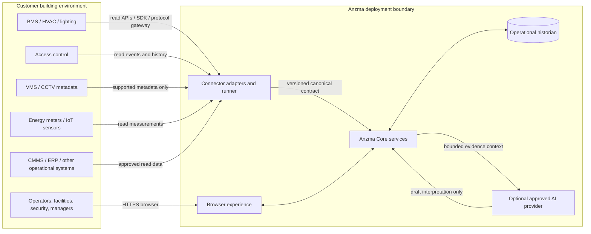
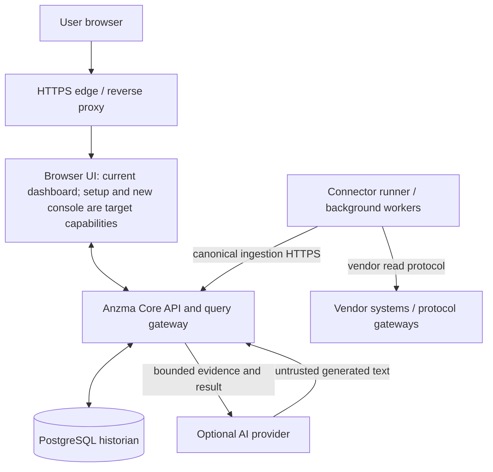
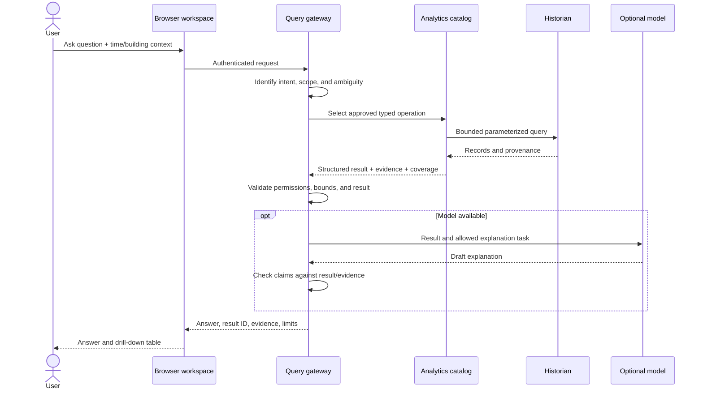
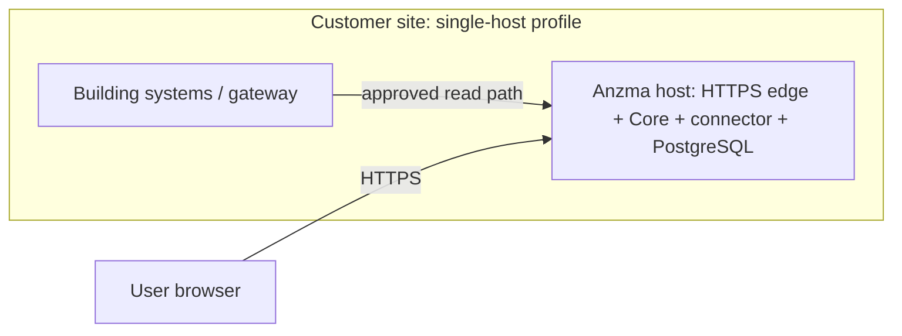
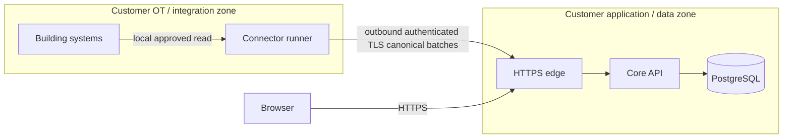
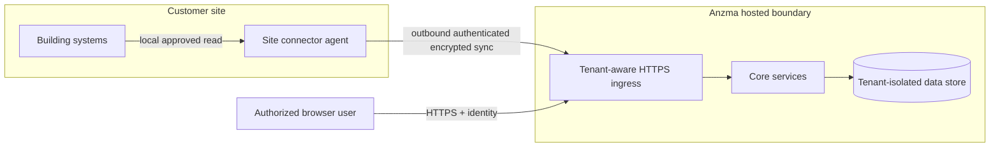

# Anzma AI Insight Whole Solution Architecture

**Status:** Working architecture for product and engineering discussion  
**Date:** 25 November 2026  
**Scope:** Product capabilities, logical systems and containers, key workflows, onboarding, deployment, integration requirements, and preliminary sizing approach. This is a target design, not a claim that these capabilities are implemented or a production hardware procurement specification.

## 1. Executive view

Anzma AI Insight is a vendor-independent operational intelligence layer installed once in a customer's supported environment. It connects to existing building systems through separately managed, read-oriented connectors; normalizes and retains the operational data the customer authorizes; derives deterministic, evidence-backed operational results; and presents those results through chat, dashboards, reports, and alerts. It complements the customer's BMS, access control, VMS, metering, and maintenance systems. It does not replace their control functions.

The Core owns canonical identities, accepted data, analytics semantics, permissions, evidence, and user-facing result contracts. Connectors own vendor communication, vendor credentials, discovery, pagination, translation, retry, and source synchronization. All product surfaces reuse the same analytics services and result identifiers. AI helps interpret a user's request and explain a verified result; it does not invent measurements, decide that missing data is healthy, or issue equipment commands.

This architecture deliberately keeps a broad product goal while releasing it in testable slices. The current repository is a simulated-data demo with established ingestion, alert/incident, freshness, dashboard, and chat foundations. A new G1 reference-REST/typed-analytics slice exists in the working tree but is not an accepted or released milestone. Sections below distinguish current foundations from the target design.

## 2. Product outcomes and boundaries

### Customer outcomes

- Connect supported existing systems without replacing them.
- Discover what a source actually exposes and understand which analytics are possible from it.
- Ask operational questions and receive reliable, scoped answers with source evidence, data coverage, and freshness.
- Monitor operational status and investigate alerts/incidents.
- Save role-appropriate dashboards and generate reports from the same trusted results.
- Add connectors and future modules without embedding vendor-specific logic into the Core.

### Trust and operating boundaries

- Read-only vendor access is the default. Anzma does not control equipment or write to source systems in the initial architecture.
- Silence, missing history, or a failed connector is not evidence that equipment is offline or healthy. Source liveness, data freshness, equipment state, and analytic coverage are distinct.
- Access-control authorization is not proof that a door physically opened. Event meaning comes from the source contract and approved mapping.
- Every analytic declares prerequisites, time semantics, data-quality rules, formula/version, evidence, limitations, and completeness behavior.
- **Recommended target policy pending ADR-11:** select the operational next action deterministically from an approved playbook and its evidence conditions; keep it concise and distinct from the AI explanation. The model may explain why the alert is present using cited evidence, but it must not create, rank, choose, remove, or execute corrective actions. If no approved action is available, state that and give the approved escalation/verification path.
- Provisional playbook text is not an approved corrective recommendation. It must be visibly marked as a draft for human review or withheld from the actionable recommendation surface until approval is recorded.
- Unknown or unsupported capabilities are shown as such; semantic mapping proposals require review when confidence is low or the consequence is sensitive.
- Personnel/attendance analytics require explicit customer policy, user attribution, purpose, authorization, and audit before activation.
- Example questions and sample numbers in the supplied visuals are acceptance/design examples, not the complete product catalog or real customer data.

The proposed pilot scorecard, metric definitions, owners and attribution rules are in [`BUSINESS_OUTCOMES_AND_SUCCESS_MEASURES.md`](BUSINESS_OUTCOMES_AND_SUCCESS_MEASURES.md). Set numeric targets only after the customer use case and baseline are agreed.

## 3. Reference and authority model

Use the supplied self-service blueprints for the customer promise and journey, the v0.2 engineering architecture for the proposed first technical release and service boundaries, and the four images as illustrative concepts. The repository and reproducible runtime evidence establish what is built today.

For a requirement-by-requirement status and evidence map, see [`PRODUCT_REQUIREMENTS_TRACEABILITY.md`](PRODUCT_REQUIREMENTS_TRACEABILITY.md).

The first image most closely matches the written install-once/browser-access promise. Other supplied images describe per-PC installation, SaaS, or different product names. These are unresolved positioning differences. Until the product owner decides, use **Anzma AI Insight** as the working name and describe the architecture as **Core deployed once, users access through a browser, embedding only where supported**. Do not claim every vendor is plug-and-play or every host application can embed Anzma.

## 4. Logical system context

Network topology is deployment-specific. A connector may run beside Anzma, near the vendor system, or in a separately controlled integration zone. Only the connector-to-Core contract is stable; vendor protocols and credentials do not cross into Core domain code. Establish the direction of network initiation and the required firewall rules per connector. Prefer outbound connector-to-Core HTTPS where customer policy allows it.

## 5. Business capability map

| Capability | Product function | Architectural owner | Current foundation / status |
|---|---|---|---|
| Connect | Register a source, verify connectivity and permissions, protect credentials | Connector management + identity/security | Per-source ingestion credentials exist. A full customer connection workflow is proposed. |
| Discover | Enumerate supported devices, points, events, history, current-state and live capabilities | Connector adapter | Reference REST exposes synthetic event history only; general discovery is not implemented. |
| Map and validate | Link external identities to Core assets and propose semantic meanings/units | Identity and semantic mapping services | External asset mappings exist; self-service review/confidence workflow is proposed. |
| Ingest and retain | Validate, deduplicate, audit, retain provenance and accepted facts | Ingestion API + historian | Versioned batch ingestion and PostgreSQL history exist. |
| Establish data trust | Evaluate quality, freshness, source health, coverage and missing data | Freshness/source services + result contracts | Freshness and source-liveness foundations exist; analytic coverage is not yet fully persisted end-to-end. |
| Analyze | Execute approved deterministic operational analytics | Analytics catalog/service | Operational alert/KPI logic exists; current G1 slice adds two specific typed analyses, not a general catalog. |
| Ask | Translate natural language to an authorized analytical request and explain returned results | Query gateway + assistant | Existing alert chat and early direct routing exist; general registry-based routing is target scope. |
| Monitor and investigate | Show status, alert lifecycle, incident grouping, evidence and source health | Alert/incident services + dashboard | Existing alert, incident, dashboard and freshness behavior exists. Replayable alert delivery remains target work. |
| Personalize | Save role-aware layouts from validated widgets | Dashboard configuration service | Proposed. |
| Report | Export a result snapshot with parameters, evidence, coverage and limitations | Report service | Proposed. |
| Extend | Add certified, configurable or custom connector/module packages | Versioned connector/module contracts | Ingestion contract exists; public connector SDK/lifecycle and support tiers need definition. |
| Operate | Install, configure, upgrade, observe, back up and recover the deployment | Deployment and operations | Local Compose demonstration exists; customer production qualification is not established. |

## 6. Target application and container architecture

Keep deployment containers aligned to operational responsibility, not to every Python module. The first supported installation can be a single server or VM running a small set of containers. A larger customer can separate database, Core, and connector runtime without changing product contracts.

| Container / process | Responsibility | Current repository evidence | Target requirement / status |
|---|---|---|---|
| **Web edge / reverse proxy** | TLS termination, host routing, optional identity-provider integration, request limits | No edge/proxy service in the main Compose file; API binds directly to the configured host address. | Add a supported TLS edge or an approved customer-provided equivalent before networked production use. |
| **Anzma Core API** | Authentication boundary, APIs, application services, chat/query gateway, orchestration | FastAPI application is built and run as the `api` Compose service. Operational APIs use the current shared deployment bearer/session model. | Evolve the Core while preserving approved contracts; replace shared identity with an approved user identity and authorization model before multi-user production. |
| **Web client** | Setup wizard, operations workspace, saved dashboards, reports, alert investigation | Current HTML/JavaScript assets are served by the API; there is no separate web container or customer setup wizard. | Browser-accessible product. A richer client may be introduced, but keep it a product choice tied to onboarding and role workflows rather than assuming a framework is already approved. |
| **PostgreSQL historian** | Canonical assets, sources/mappings, telemetry/events/state, batches/rejections, alerts/incidents, configurations and audit | PostgreSQL 16 is the `db` Compose service with a persistent volume. Fresh-volume init mounts migrations only through 012; the runner discovers unapplied migrations 006+ for explicit execution. | Retain as the persistence base; version and rehearse one repeatable fresh-install and upgrade migration path, backup, restore, and retention. |
| **Connector runner** | Runs approved adapters, stores/loads connector configuration, polls or subscribes to sources, checkpoints progress, posts normalized batches | A separate synthetic reference REST server and a one-shot environment-configured connector exist in the working tree, but neither is wired as a service in the main Compose file; connector configuration/checkpoints are not customer-managed. | Package and manage isolated connector processes with approved config/secret lifecycle, durable sync checkpoints and health. Never write Core tables directly. |
| **Optional AI model service** | Local or approved external model inference | Ollama and a model-pull init service are in Compose. The default image tag is `latest`; model choice defaults to `qwen2.5:3b`. | Pin and qualify runtime/model versions for release. Keep deterministic analytics available during model outage. Model selection dictates separate hardware planning. |
| **Background evaluator** | Scheduled freshness, source-health, alert, and retention jobs | Freshness runs as an opt-in Compose profile; other scheduled work remains in the API or existing job processes. | Separate workers when load/reliability needs it; make jobs idempotent and expose last-success and failure state. |
| **Optional artifact storage** | Report exports and larger generated artifacts | No artifact-storage service is present in the current Compose stack. | Add when report persistence requires it. Use bounded retention and authorized downloads; PostgreSQL remains the source of record for result metadata. |

**Install-path implication:** the current stack is a local demonstration topology, not a complete customer installer. A fresh PostgreSQL volume initializes through the SQL mounts in Compose; migration 013 and later require the documented `scripts/apply_migrations.py` runner. The runner discovers unapplied migration files, but that step is not orchestrated by the main Compose startup. The reference REST source/connector is also not orchestrated by the main Compose file. The release path must make fresh installation and upgrade converge on the same schema and must package or deliberately document connector lifecycle before promising one-time self-service setup.

### Data ownership and flow

1. A connector reads source data under source-specific least-privilege credentials.
2. It translates vendor IDs, timestamps, units, event meaning and quality into the canonical contract and preserves upstream IDs/provenance.
3. Core authenticates the source, checks scope and mapping, validates each record, and stores accepted/duplicate/rejected outcomes with audit information.
4. Freshness and operational services derive current views from stored facts; source silence remains separate from a device fault.
5. The analytics service runs a registered, parameterized operation with authorized building/source scope and declared prerequisites.
6. A common result envelope returns parameters, generated time, evidence references, totals, coverage/completeness, quality, truncation and limitations.
7. Chat may explain the result. Dashboard widgets and reports consume the same result contract or a reproducible query version; they do not reimplement formulas.
8. Alerts/incident lifecycle and stream/replay APIs present operational events independently from analytics answer freshness.

## 7. Canonical product modules

These are logical boundaries. They need not each be a microservice or container.

- **Connector contract and registry:** versioned manifest; supported domains/capabilities; health; authentication mode; pagination; freshness model; compatibility; lifecycle and diagnostics.
- **Connector runtime:** bounded network access, credential references, source-specific retries/backoff, cursor/checkpoint persistence, rate limits and normalization.
- **Identity and semantic mapping:** source/building/asset/external ID, hierarchy, mapping approval, metric/event meaning, units, confidence and mapping history.
- **Ingestion and historian:** versioned normalized batch contract, idempotency, audit, retention and queryable evidence.
- **Operational state and freshness:** current state, stale/missing/invalid distinctions, source liveness, data-gap lifecycle, evaluation timestamps and building time zones.
- **Analytics catalog:** typed input schema, access policy, prerequisites, computation, version, result schema, evidence builder, coverage rules and tested fixtures.
- **Query gateway and AI orchestration:** resolve request to a registered operation, authorize it, validate parameters, execute bounds, pass structured result to the model, validate claims and return grounded answer plus result ID.
- **Alerts and incidents:** deterministic detection, evidence, grouping, acknowledgements/resolution, stable event IDs and replay/backfill behavior.
- **Dashboard configuration:** versioned approved widget specifications, layouts, role/building scope, persistence and query binding. No arbitrary generated JavaScript or SQL.
- **Reports:** template, result snapshot, parameters, sources, coverage, evidence references, export format, access control, audit and retention.
- **User identity and authorization:** authenticated user, role, building/system/data-category scope and attributable audit. Separate user identity from connector identity.
- **Operations:** health/readiness, structured logs without secrets, metrics, backup/restore, migrations, upgrade/rollback behavior and deployment diagnostics.
- **Optional knowledge retrieval:** curated manuals, procedures and approved asset/vendor relationships may be indexed for contextual answers. This is separate from the PostgreSQL telemetry and deterministic analytics path. A GraphRAG-style index is only a candidate if tested questions show relationship/global-context retrieval adds value; it introduces indexing/storage work and can use LLM tokens for indexing and query context.
- **Platform metrics/observability:** a Graphite-compatible metrics service is one candidate for host, container, API, database, connector and model health metrics. It is not the business telemetry historian and is not part of the current Compose stack. Its RAM and storage depend on metric count, sampling and retention; it does not use LLM tokens unless someone explicitly forwards metric values into a model prompt.

The proposed business-facing operation families and their prerequisites are detailed in [`ANALYTICS_CAPABILITY_CATALOG.md`](ANALYTICS_CAPABILITY_CATALOG.md). That catalog is deliberately separate from the chat parser: adding an approved analytic should register a capability, not create a new hard-coded chat branch.

Keep the terms distinct in architecture and planning: **Graphite** is a metrics/monitoring stack; **GraphRAG** is a knowledge-indexing and retrieval approach for model context. Neither is installed in the current deployment. Keep operational facts and calculations in the authorized Core/analytics path even if a future retrieval or monitoring service is added.

## 8. Customer and operator workflows

### Roles and permission intent

The following are proposed product personas, not roles already enforced by the current application. Model authorization as a role plus site/building, system, and data-category scope. A person may hold more than one approved role, but scope and audit attribution remain explicit. Connector service credentials are never human user accounts.

| Persona | Primary jobs | Intended access | Boundary |
|---|---|---|---|
| **Facilities operator** | Monitor building systems, investigate equipment alerts, review approved HVAC/energy/maintenance insights | Operational dashboards, assigned building assets, incident evidence, approved analytics, acknowledge/resolve where authorized | No building control through Anzma; no access to unrelated buildings or personal access logs by default. |
| **Security operator** | Review door/device/VMS events, investigate security incidents, prepare approved security reports | Assigned security systems/buildings, permitted event details and incident workflows | Person identity and attendance fields are separately permissioned; access grant is not physical opening evidence. |
| **Building/portfolio manager** | Compare service levels, energy and alert trends; review status and reports | Read-only approved aggregates across assigned buildings; saved dashboards and exports within scope | Person-level data is excluded unless a separate policy and permission explicitly allow it. |
| **Site IT / integration administrator** | Register a source, test connectivity, inspect capabilities, maintain mappings and rotate connector credentials | Connector configuration and source health for assigned site; mapping review and sync diagnostics | Cannot grant self broader data access, view secret values after provisioning, or issue equipment commands. |
| **Data/analytics steward** | Approve event meanings, KPI definitions, prerequisites, thresholds and validation fixtures | Catalog definition/versioning and synthetic/sanitized validation data | Approval of an analytic does not grant access to every customer's operational data. |
| **Anzma deployment operator** | Install/upgrade Core, monitor service health, recover deployment and manage backups | Platform-level maintenance with least privilege and attributable, time-bounded customer-data access only when support is authorized | Deployment administration does not automatically confer business-user visibility into customer data. |
| **Connector service identity** | Read the vendor source and submit normalized records | Source-specific read permissions and one Core ingest scope for a registered source/building | No interactive login, analytics query, dashboard or human permissions. |

Default-deny at every API, chat tool, dashboard widget, report/export and stream. Scope must be applied before query execution, not only hidden in the UI. Do not use aggregate labels to leak a person's status through small groups or drill-downs. Decide whether the first release uses customer OIDC/SSO or another attributable identity model in ADR-04; the existing shared operator token is a demo limitation and cannot prove these boundaries.

### 8.1 First-time setup

1. **Deploy once:** an authorized IT/site operator chooses the supported on-premises server, VM or approved cloud pattern; configures network, TLS, secrets, storage and backup.
2. **Sign in and create site/building context:** establish building identity, time zone, locations, users/roles and the initial system catalog.
3. **Add a connector:** choose a certified connector or supported protocol, enter credentials through a protected secret input, and test reachability/permissions. Never ask users to paste secrets into chat.
4. **Discover:** show actual exposed assets, points, events, history, live functions, paging limits, and source restrictions. Report unsupported/empty distinctly.
5. **Review mappings:** propose semantic mappings from metadata/units/hierarchy; show confidence, evidence and conflicts. Require approval for ambiguous or consequential mappings.
6. **Select analytics:** list each operation as ready, needs input, or unavailable, with prerequisites and reason. Configure schedule/time zone only where required.
7. **Activate:** run an initial bounded sync, validate results and source freshness, create a role-appropriate starter dashboard, then allow users to use chat/reports/alerts.
8. **Operate:** surface connector health, last successful sync, data gaps, Core readiness, storage and backup state; provide guided reconnect/rotation/upgrade flows.

The blueprints' promise of no professional services is conditional on a certified self-service connector and a supported environment. Custom vendor integration, network/firewall changes, legacy protocol gateways, or ambiguous point mapping may require customer IT or an Anzma integration engagement. Publish support tiers rather than claiming universal plug-and-play.

### 8.2 Asking an operational question

If the question is ambiguous, ask for clarification or show the assumed filters. If prerequisites are missing or coverage is unknown, state that limitation. Do not convert an empty local query into a claim that the upstream system had no matching data.

### 8.3 Alerts and incident investigation

The source connector reports a source fault/transition or a fresh batch. Core stores the record, evaluates deterministic alert rules and source/data freshness separately, groups related alerts into incidents, and emits a stable event ID. The browser receives new events and can fetch after a cursor to reconcile after reconnect. The operator reviews evidence, acknowledges or resolves the incident, and sees the lifecycle update. A missing recovery transition leaves state uncertain/open according to the rule; silence alone does not create an equipment-offline event.

### 8.4 Saved dashboard and report

The user asks for a view or report. The system proposes a layout using approved widget IDs and analytics parameters. It validates scope and schema, shows the preview/result, and requires an explicit save. Report generation binds to a result ID/version and includes its filters, generation time, sources, coverage, and limitations. On later refresh, the UI identifies that values are current recalculations rather than silently changing a frozen report snapshot.

## 9. Integration and device/source requirements

There is no single universal Anzma field-device specification. A device is integrated through the existing building system or an approved protocol gateway and connector. Each connector must publish a compatibility profile and be qualified against real source behavior.

### Minimum source capability profile

| Requirement | Minimum / expected behavior |
|---|---|
| Stable identity | Stable vendor object/device/event ID; parent hierarchy and location where available; mapping can survive restart and rename. |
| Read access | Dedicated least-privilege read-only account/API key; documented endpoints/SDK permissions; no control/write permission in initial release. |
| Data semantics | Event/point type, unit, value type, source timestamp and quality/status where provided. Distinguish explicit transitions from silence. |
| Time | UTC timestamp or documented source timezone/offset; source clock and NTP behavior understood; preserve observed time and Core received time separately. |
| History | Range filters and bounded pagination for historical queries where capability is advertised; limits and retention disclosed. |
| Current/live | Optional current-state reads, subscriptions, webhook or polling; advertise actual capability and expected latency. |
| Reliability | Rate limits, timeout behavior, transient/permanent errors, retries, cursor stability, duplicate handling and recovery procedure documented. |
| Network/security | TLS with certificate validation where supported; approved direction/ports/hosts; no arbitrary Core-to-internet URL fetching; credential rotation path. |
| Evidence | Source event/point IDs retained so analytics can drill down and reconcile. |

### System families to qualify

- **BMS/HVAC/lighting:** equipment, point values, operating mode, explicit alarm and status events; BACnet/OPC UA often need a gateway or vendor connector. Never infer controllability from read capability.
- **Access control:** credential decision, door contact/open, forced/held, controller health and identity are separate event types. Personnel fields need privacy controls.
- **VMS/CCTV:** camera/controller online and recording-health metadata only where exposed and authorized. Video footage processing is outside the initial read-oriented analytics scope unless separately approved.
- **Meters/IoT sensors:** energy, occupancy, environmental and device health with unit, interval, calibration/quality and expected reporting cadence.
- **CMMS/ERP/work orders:** maintenance context and work-order state when an API provides stable records and authorized fields; not required for the initial connector demonstration.

For every connector, publish: vendor/product/version, supported firmware/API versions, supported objects and fields, history depth, rate limits, polling/subscription behavior, network requirements, credential scope, known gaps, and qualification evidence. A connector manifest claiming `history.events` must not imply telemetry, live events, people schedules, or camera recording health.

Use [`PILOT_SYSTEM_QUALIFICATION_TEMPLATE.md`](PILOT_SYSTEM_QUALIFICATION_TEMPLATE.md) to capture the first real site's system/device, connectivity, data, privacy, and workload evidence. Fill it with the customer and vendor before claiming compatibility or setting hardware requirements.

### Customer-facing connector support tiers

Publish support by **connector + source product/version + capability**, not by vendor name alone. The same source may qualify for historical events but not current telemetry or live events. Discovery results must reflect the customer's installed licenses, permissions and configuration.

| Tier | Customer expectation | Entry criteria | Customer / partner work | Sales and support claim |
|---|---|---|---|---|
| **Certified self-service connector** | The customer can connect the listed source through the guided flow without writing code or SQL; the UI shows exactly what is supported. | Named vendor/product/API or firmware versions; reproducible security and conformance tests; real (or vendor-approved) source fixture; successful capability discovery, mapping, history/paging, restart and recovery cases; reviewed setup and compatibility guide; signed-off analytic prerequisites for claimed operations. | Provide approved read-only account, endpoint/network access, and review any ambiguous semantic mappings. Site-specific exceptions route to another tier. | May be described as self-service only for its listed product versions and declared capabilities. Do not imply every signal, API module or license is included. |
| **Configurable protocol/API integration** | The source exposes a supported interface, but each site needs configuration, gateway, inventory import, credentials or mapping assistance. | Interface and source family are known; a documented connector/template can be configured without unreviewed Core/vendor code; supported fields and limitations are inventoried; site-level access and test plan exist. | Customer IT or an Anzma/integration partner configures the gateway/network, provides an inventory, and approves mappings. | Describe as configurable; do not promise minutes/no professional services. Estimate setup after source review. |
| **Custom integration required** | Existing certified/configurable paths do not cover the source, required fields, security model or history/live capability. | Scoping confirms that a vendor SDK, custom protocol, new source adapter or product contract change is necessary; licensing, ownership and test access are understood. | Joint discovery and delivery estimate; dedicated acceptance and support agreement. | Not plug-and-play and not a supported connector until separately implemented, qualified and listed. State exclusions and estimate separately. |

**Qualification rule:** a support-tier claim expires or changes when the vendor version, connector version, required capability, credential scope, or Core contract changes. Keep a compatibility matrix and retest supported combinations. A connector's single manifest is not proof of the setup UX, user permissions, analytic correctness or whole-product deployment.

**Current status:** the reference REST service is synthetic and demonstrates a connector mechanics path only. No real vendor/device connector has been qualified at any customer support tier. The existing reference simulator is also synthetic. Treat both as development tools, not Certified Self-Service offerings.

## 10. Deployment and installation model

### Deployment options

1. **On-premises server or VM:** preferred first customer/pilot pattern where building data cannot leave site. Customer controls host, network and backup; Core and PostgreSQL may share the host initially.
2. **Private cloud / customer cloud:** same artifacts and contracts in a customer-controlled network, subject to source connectivity and identity/backup requirements.
3. **Vendor-hosted SaaS:** a possible later operating model, not a current capability claim. Requires a decided tenant-isolation, operations, identity, retention, compliance and support model.

The first image's install-once/server/VM plus browser-access story is the working target. Do not design around per-PC Core installation. Per-PC connector agents may be justified only for a specific network/protocol boundary and must be described as connector deployment, not user application installation.

### Deployment topology alternatives

These are component-placement alternatives, not three qualified product offers. Actual port numbers, certificate policy and direction of network initiation must be agreed with the customer site/network owner for the chosen source.

| Profile | Component placement | Source connectivity | Main business/operational consequence | Evidence/status |
|---|---|---|---|---|
| **A. Single-site host** | Reverse proxy, Core API, connector runner and PostgreSQL on one supported server/VM; optional local model is separately enabled. Users connect by browser. | Host/connector reaches approved source APIs or protocol gateway through the customer's building network. Restrict routes and credentials to the necessary source scope. | Simplest install and support boundary for a small pilot; host failure affects all local components unless backed up/recovered. Network access from this host into an OT zone needs explicit site approval. | Existing Compose approximates this topology, but it is a local demo, not production-qualified. |
| **B. Split customer network** | Core/API and PostgreSQL in customer application/data zones; connector runner is placed near the vendor/OT network or in an approved integration zone; browser enters through customer HTTPS edge. | Prefer connector-initiated outbound TLS to Core. If source protocol needs local discovery or low-latency polling, connector reads locally and sends normalized batches out; Core does not need direct vendor access. | Better network segmentation and source locality; requires approved firewall routes, connector operations and monitoring across zones. | Proposed. Must be tested with the pilot network and customer IT/security. |
| **C. Anzma-hosted service** | Core, database, web edge and workers run in Anzma-controlled cloud; each customer has an explicit identity, authorization and data-isolation boundary. | A site-side connector/agent initiates authenticated encrypted outbound sync to the customer's service endpoint; avoid opening inbound connections into the building network. | Anzma assumes service availability, security operations, upgrades, backup/restore and tenant support. Data residency/egress and incident responsibilities become commercial commitments. | Not implemented or qualified; requires an approved SaaS and tenant architecture before customer claims. |

For profile C, “tenant-isolated” is a required design property, not a decision that shared tables are acceptable. The isolation mechanism (separate deployment/database, schema, or verified row-level isolation), region/residency, service availability and customer-data support access must be decided and tested before hosted use.

### Installation and upgrade sequence

1. Verify host OS/CPU/RAM/disk against a qualified release profile; verify Docker/container runtime or selected installer, DNS, NTP, TLS, firewall and source reachability.
2. Allocate persistent database and artifact storage; configure backup destination and restore owner before importing customer data.
3. Install a versioned Anzma release bundle and deployment configuration. Keep passwords/API keys in the deployment secret store, not source, images, prompts, or logs.
4. Start PostgreSQL and Core dependencies; initialize an empty database or run the documented migration path for an existing deployment. Take and verify a backup before upgrade migrations.
5. Configure TLS/identity, create the first operator, set building/timezone, configure source scopes, and verify readiness.
6. Install/enable only the required connector runners; provision per-source credentials and external identity mappings; run connectivity and capability tests.
7. Perform discovery, mapping approval, first sync, data-quality/freshness checks, analytic fixture reconciliation and dashboard smoke review.
8. Enable chat, alert delivery, reporting and any optional model only after their prerequisites and access controls are validated.
9. Record release version, migration version, connector versions, configuration backup, health state and acceptance evidence.

The existing Docker Compose install is a useful engineering baseline, not proof of customer-ready installation. Packaging, upgrade automation, rollback, backup/restore drills, TLS, user identity and a customer-like walkthrough remain release gates.

## 11. Preliminary infrastructure sizing and device planning

No measured production load, customer asset count, event rate, history retention, concurrency, report volume, model choice, or availability target is established by the supplied materials. Therefore this document does **not** approve production hardware purchase specifications.

The pilot sizing inputs and sign-off evidence are collected in [`PILOT_SYSTEM_QUALIFICATION_TEMPLATE.md`](PILOT_SYSTEM_QUALIFICATION_TEMPLATE.md) §6–7.

For the pilot, collect these inputs and run a load test before fixing a supported size:

- assets and points by connector; average/peak samples per second; event bursts; history/backfill range;
- connector polling interval, API rate limits, payload sizes and sync concurrency;
- query concurrency, dashboard refresh, alert latency target, report/export volume and retained artifacts;
- retention and backup window, database growth, restore-time objective, and offline duration to buffer;
- whether a local model is required, model/context size, concurrent inference, and GPU/CPU/memory needs;
- number of buildings/customers and whether isolation is shared-database, schema, or separate deployment;
- uptime, recovery, maintenance windows, and support ownership.

Then publish qualified tiers (pilot, single-site production, multi-site) with CPU cores, RAM, NVMe capacity/IOPS, network interfaces, supported OS/container runtime, backup sizing, and model accelerator requirements. Size storage from measured bytes per record and retention rather than an arbitrary fixed disk claim. The first pilot should benchmark Core/PostgreSQL with and without the optional local model because inference can dominate compute and memory.

### Working planning profile for scenario comparison

The following profile captures the current planning proposal for discussion. It is **not a measured minimum, customer commitment, or approved procurement specification**. Use the pilot qualification template to replace every assumption with source and workload evidence.

| Input | Working assumption | Repository / arithmetic check |
|---|---|---|
| Standard site | About 3,000 points, 5-minute reporting, 90 days online (~78 million telemetry rows) | `3,000 × 288 samples/day × 90 = 77,760,000` only if 3,000 is the total point count for the whole site and all points report on schedule. Confirm if the count is per building or per site. Validate actual row size, indexes, WAL and retention. |
| Scale unit | 2 buildings, 5 systems, 248 assets | The demo contains five system types but only 12 seeded assets. The 248-asset volume is a target for sizing, not current prototype evidence. |
| Users | 10 concurrent users, 5 roles | Planning assumption. Current operator access uses a shared deployment token; named users, enforced roles and per-building authorization are not verified. |
| AI | 7–8B Q4 model, Arabic and English, 2–4 simultaneous responses | Planning target. The current Compose default is Qwen2.5:3b. Model quality, response time, context, parallel requests and peak RAM/VRAM have not been qualified for Anzma. |
| Services | PostgreSQL 16, API/dashboard, freshness worker, Ollama, connector container | PostgreSQL, API, Ollama/model initialization are in the main Compose file; freshness is opt-in. A production connector container is not wired into that Compose stack. The reference simulator/connector path is synthetic and separate. |
| Data boundary | Read-only; no video footage storage; CCTV events only | Matches the intended boundary. Current records are synthetic; CCTV/event metadata can still be sensitive and needs customer policy. |

#### One-Core RAM planning estimate

| Component | Planning range |
|---|---:|
| OS and Docker | 4 GB |
| PostgreSQL for the assumed workload | 8–16 GB |
| API, Socket.IO, freshness and reports | 3–4 GB |
| Future connector container | 1–2 GB |
| 7–8B model on CPU | 6–10 GB |
| Subtotal | 22–36 GB |
| Subtotal plus 30% headroom | 28.6–46.8 GB (rounded planning band: about 32–48 GB) |
| Proposed Core tier | 64 GB system RAM; confirm under peak workload |

These are component estimates, not measurements. GPU VRAM is separate from host RAM, but GPU inference still needs host RAM for the OS, runtime, API, buffers and data. Model weights are only one part of inference memory; context length, KV cache, runtime workspace and concurrent sequences change the requirement. A 64 GB tier is a defensible benchmark target, not a guarantee or purchase approval.

#### Scenario sizing proposal

| Scenario | Core planning tier | AI planning tier | Connector placement | Intended use and boundary |
|---|---|---|---|---|
| **S0 — Evaluation PC** | 8 CPU cores, 32 GB RAM, 512 GB SSD | 3–4B model; optional 6–8 GB GPU | None required | Seeded/simulated data for demos and engineering evaluation only. |
| **S1 — On-prem all-in-one** | 16 cores, 64 GB RAM, 2 TB NVMe | 7–8B Q4 target; 16–24 GB GPU is a candidate after benchmark | Connector planned as a separate container on the Core host; this service is not in current Compose | Simplest live single-site option if customer IT approves the Core’s read-only routes to building APIs. |
| **S2 — On-prem Core plus site gateway** | Same proposed Core tier as S1 | Same AI placement and benchmark gate as S1 | Gateway planning tier: 4 cores, 16 GB RAM, 256 GB SSD, 2 network ports; enforce a non-routing OT/IT boundary | Use when site policy requires only the gateway to access OT sources. Buffering/replay needs implementation and failure testing. |
| **S3 — Private cloud Core plus site gateway** | 16 vCPU, 64 GB RAM, 1–2 TB managed disk plus snapshots; vCPU is not automatically equivalent to a physical core | Local 7–8B target with a cloud GPU around the 24 GB class, or a separately approved hosted model | Same gateway planning tier as S2; outbound site connection | Multi-site option only after data-residency, connectivity, operator, recovery and recurring-cost decisions. |

For S1–S3, one shared Core sizing profile reduces product variants; the gateway is an add-on. A backup target of roughly twice the database size is only a placeholder: derive capacity from database growth, retention, WAL, restore time and off-host copies. Private-cloud snapshots do not replace a separate recovery plan.

#### CPU versus GPU decision

| Measure | CPU-only local inference | Local inference with 16–24 GB GPU |
|---|---|---|
| 7–8B answer time (~300 words) | 20–60 seconds (unverified planning estimate) | 3–8 seconds (unverified planning estimate) |
| Ten users | Requests may queue; actual waits depend on request frequency and workload | 2–4 simultaneous responses are a test target, not an established capacity |
| Arabic/English quality | May require a smaller model or slower responses; benchmark both languages | More room for the 7–8B class; quality still requires bilingual evaluation |
| Cost and operations | Lower initial hardware cost; more CPU/RAM contention with Core services | GPU is a major hardware cost and adds driver, runtime and support requirements |
| Proposed role | Demo or low-concurrency pilot if measurements meet the use case | Candidate production tier only after quality, latency, concurrency, failure and recovery checks pass |

The working path is S0 for demos; S1 as the first live-site candidate; S2 when OT segmentation requires a gateway; and S3 as a later private-cloud option. Keep GPU optional until the benchmark demonstrates it is needed. No latency or concurrency figure in this table is an SLA.

### Customer-site network and source equipment checklist

- Source systems expose a supported read API/SDK or connect through an approved gateway.
- A dedicated source account exists with only the necessary read permissions.
- Connector host can reach source endpoint and Core endpoint over explicitly approved ports; DNS, TLS trust and certificates work.
- Clocks are synchronized and timestamp semantics are documented.
- Source supports the required history depth and paging for the chosen analytics; source retention is not confused with Core retention.
- Device/object inventory contains stable external IDs and enough metadata to review mappings.
- Vendor licenses permit the requested API/history use; any camera/person data scope is approved.

## 12. Security, privacy, and reliability architecture

- Separate connector credentials from operator identities. Store source keys hashed in Core where applicable and vendor secrets in a protected deployment secret store.
- Enforce user authentication and authorization at every API/tool/report/dashboard operation: role, building, system and data category. Current shared operator token is a demo limitation, not a sufficient personnel-level authorization model.
- Treat connector payloads, vendor text, and model output as untrusted. Parameterize queries; use a registry of bounded tools; reject raw SQL/code and unregistered destinations.
- Keep action selection outside model inference. Deterministic rule/playbook logic owns recommendation eligibility and ordering; model output cannot change the selected action or turn provisional content into approved guidance. Any work-order creation or acknowledgement remains an explicit authorized operator action with an audit record.
- Apply pagination, time-range, row-count, payload-size, timeout, concurrency and rate limits at connector and Core boundaries.
- Keep observed, received, evaluated and generated times distinct. Show stale snapshots and source outages rather than presenting old data as live.
- Persist checkpoints and event IDs where source APIs support them; make ingestion idempotent; support bounded replay/backfill and operator-visible sync gaps.
- Audit mapping approvals, credential changes, user queries/exports according to an agreed privacy and retention policy. Never log secrets.
- Health/readiness endpoints distinguish process liveness from dependencies. Model outage must not disable deterministic analytics. Database unavailability must not be reported as a healthy empty result.
- Define database backup, off-host retention, encryption, restoration drills, migration controls, incident response and release rollback before production qualification.

## 13. Delivery architecture and release gates

The CEO self-service blueprint defines customer/product gates, while the v0.2 engineering plan defines narrower technical increments. They are related but not equivalent. In particular, **v0.2 G1 Connected Chat does not pass CEO G1 Guided Connection**: its synthetic REST source and two analytics are a technical proof, while CEO G1 requires a customer-run guided connection experience. Keep product acceptance and engineering completion separate:

| CEO product gate | Related v0.2 engineering work | CEO-level demonstrable exit |
|---|---|---|
| G0 Baseline | v0.2 G0 baseline/contracts | Current behavior inventory, decision boundaries, APIs/semantics agreed, golden fixtures and reproducible baseline. |
| G1 Guided connection | v0.2 G1 Connected Chat is a partial technical precursor, not gate completion | Customer runs the guided connection flow, tests an independently running reference API, and completes setup without source-code or SQL edits. |
| G2 Discovery and mapping | No dedicated v0.2 increment; requires a product workstream | Discover actual capabilities/assets/points; review and approve mappings; cover uncertain, conflicting and unsupported cases. |
| G3 KPI activation | v0.2 G1 analytics plus extensions from v0.2 G2 | Customer sees available/partial/unavailable operations with reasons; at least two questions reconcile deterministically to source evidence with coverage and limitations. |
| G4 User experiences | v0.2 G2 Insight Actions | Same approved result powers chat, report export and at least two saved dashboards; edit/reload and scoped permissions are verified. |
| G5 Release qualification | v0.2 G3 Live & Embedded + G4 Release | Live/reconnect/backfill, supported embedding, clean install/upgrade, security, performance, recovery, independent QA and release evidence. |

The current uncommitted v0.2 G1 slice is a useful proof of connector-to-Core-to-chat mechanics, but it uses synthetic data and manual external-ID mappings and has no guided setup wizard. It cannot be represented as CEO G1 or G2 complete. See [`DELIVERY_ROADMAP.md`](DELIVERY_ROADMAP.md) for dependencies and closure criteria.

Passing a gate requires an immutable revision, reproducible commands, named environment, positive and negative cases, and artifact evidence. A design document or passing unit test alone does not establish a production-ready feature.

## 14. Key decisions and recommended defaults

These are recommendations for discussion, not recorded CEO approvals.

| Decision | Recommended starting point | Why / what still needs agreement |
|---|---|---|
| Deployment promise | Install Core once on supported server/VM; browser access; embedding only on approved hosts | Aligns written promise and strongest matching visual. Decide whether hosted SaaS is in the commercial launch. |
| Integration posture | Read-only, separately deployed connectors using one versioned Core ingestion contract | Preserves vendor independence and avoids unauthorized control. Decide supported connector deployment/network patterns. |
| Initial product proof | Reference REST connector plus a few reusable deterministic analyses | Demonstrates end-to-end architecture without pretending to certify a vendor. Decide which real pilot system follows. |
| Analytics semantics | Named owner and review for canonical meanings, formulas, quality, coverage and golden data | Prevents business definitions from being hidden in chat code. Assign approver for each KPI family. |
| AI boundary | Intent interpretation and evidence-bounded explanation; approved typed analytics only | Makes model replaceable and operational claims reproducible. Decide model provider and local inference requirement per site. |
| Access | User identity/RBAC before personnel queries or customer multi-user production; source credentials remain separate | Shared token currently cannot attribute individual users. Decide OIDC vs managed accounts and role matrix. |
| Data isolation | Treat each pilot deployment/building boundary explicitly; do not claim multi-tenant SaaS before isolation decision | Organization/customer model is open in current docs. Decide separate deployment vs shared service. |
| Product name and visual system | Anzma AI Insight as working name; standardize brand and correct conflicting visuals | Prevents customer confusion across Anzma Core/WorkInsight/ModuBox. |
| Retention/SLA/sizing | Measure pilot workload, then qualify tiers and targets | No workload evidence currently supports production hardware/availability numbers. |

## 15. Open questions to resolve during architecture review

1. Which customer/site and real source system define the first pilot, and who owns its vendor credentials and network changes?
2. Is the first sellable release on-prem/private cloud only, or must vendor-hosted SaaS be included?
3. Who installs and upgrades Core and connectors: customer IT, Anzma, or a deployment partner?
4. What user identity source, roles, building scope, audit retention, and privacy rules are required?
5. Which data families are in first release: building operations only, or personnel/attendance too? Personnel should remain disabled until policy and identity are approved.
6. What source capabilities and history depth are available, and what alert/query latency is commercially meaningful?
7. Which KPI definitions and evidence rules are owned/approved by the data intelligence lead and business owner?
8. What are retention, backup destination, RPO/RTO, offline buffering, availability, and support expectations?
9. Is local AI required in every deployment? If so, which model and what response-time/concurrency target?
10. Which product name, visual identity, and deployment promise should replace the conflicting illustrative visuals?

## 16. Current-state versus target-state summary

**Existing foundation:** simulated building dataset; PostgreSQL; versioned source-authenticated ingestion; source/external-asset mappings; freshness and source-liveness jobs/APIs; deterministic alerts/incidents and action-candidate playbooks; provider-neutral model contract with an Ollama adapter; evidence-grounded chat/fallback; browser dashboard; local Compose deployment; reference simulator. Current alert explanation still allows model selection among eligible causes/actions and playbook actions are provisional by default, so the stronger sensitive-action policy above remains unimplemented pending ADR-11.

**Current uncommitted G1 slice:** separate synthetic REST history service and connector; two typed analytics; early chat routing and structured text table; additive event vocabulary migration and focused tests. The slice reports unknown upstream completeness, lacks persisted result snapshots and synchronization checkpoints, has limited date-only intent parsing, requires preconfigured external-ID mappings, and has no successful browser visual verification recorded in its G1 status.

**Target gaps:** end-user connector setup; generalized discovery and semantic mapping review; connector health/capability registry; broad analytics catalog and query authorization; persistent, coverage-aware result snapshots; saved dashboards; report generation; replayable live event stream; embedded chat; per-user authorization; customer installation/upgrade packaging; production monitoring/backup/recovery; qualified sizing and independent customer-like QA.

Do not treat current repository tests or historical verification reports as proof of the target gaps. Verify each capability at its own release gate and revision.

## 17. Immediate architecture decisions for the next review

The architecture is now concrete enough to review as a whole. Use [`ARCHITECTURE_DECISION_REGISTER.md`](ARCHITECTURE_DECISION_REGISTER.md) to record decisions without losing ownership or downstream impacts. The most important first decision is the **launch deployment promise**: on-prem/private-cloud Core installed once with browser users, or SaaS included from the first commercial release. That choice drives tenant isolation, identity, network topology, operations ownership, support, backup, and sizing. The next decision is the first real pilot system and its available read interface; without it, vendor compatibility and device sizing remain qualification criteria rather than facts.
