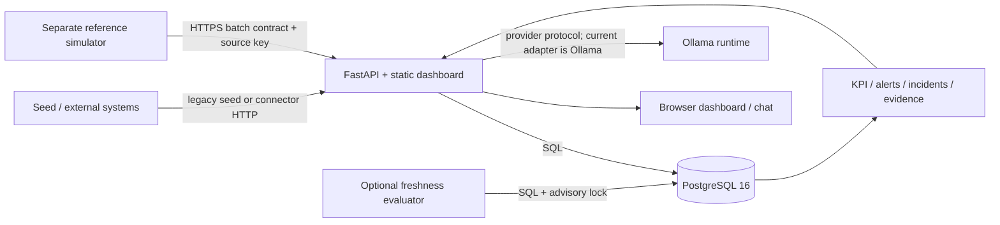
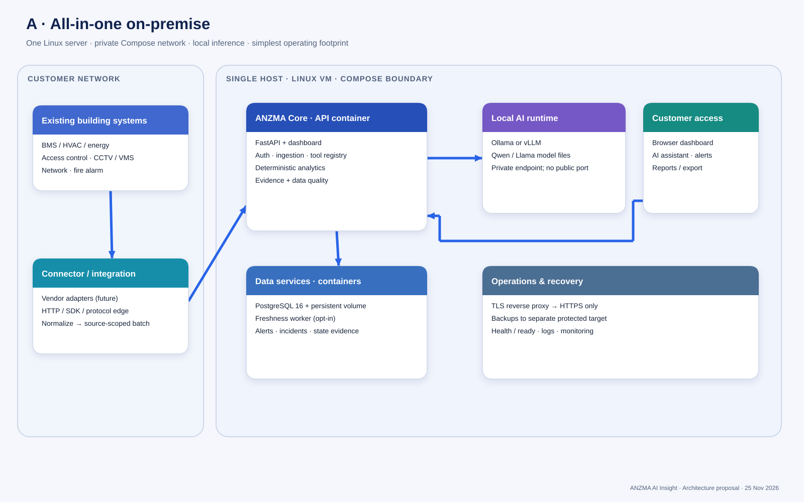
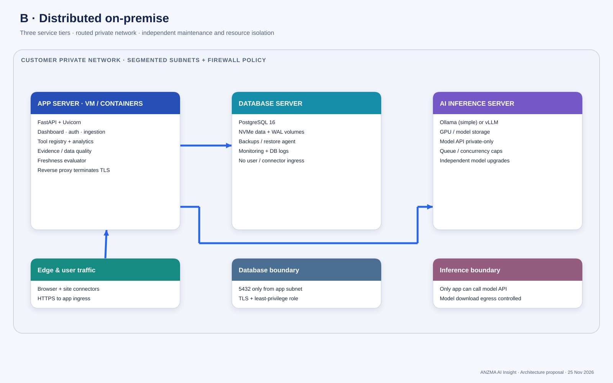
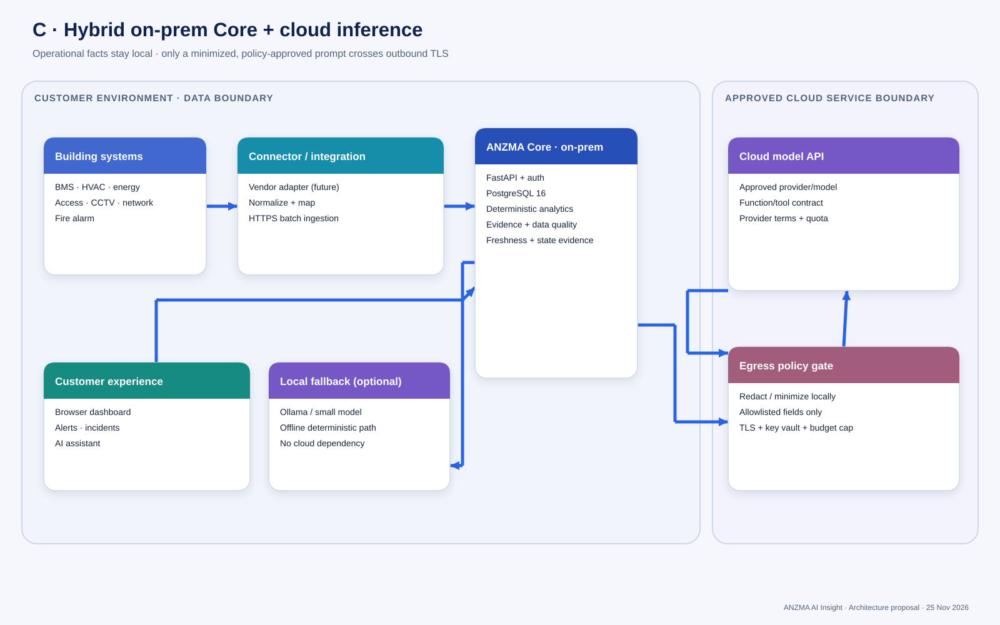

# ANZMA AI Insight — Technical Architecture Alternatives & Infrastructure Study

**Review date:** 25 November 2026
**Status:** Engineering proposal; customer deployment requirements and final architecture are not approved.
**Scope:** Architecture, infrastructure, model options, deployment planning, cost method, and acceptance gates. No application behavior or deployment configuration was changed for this study.

**Checkout note:** The working tree was already dirty when this study began. Existing unrelated edits were preserved. Migration 014 and tool-registry changes were present but uncommitted and were not treated as released or verified behavior.

> This study separates repository evidence from proposals. The supplied product blueprint is a target experience and a design reference; its wizard, saved role dashboards, broad plug-and-play coverage, and universal onboarding claims are not represented as current capabilities.

## 1. Executive summary

Anzma Core is an on-premise-capable FastAPI application with a static dashboard, PostgreSQL 16 data store, ingestion and legacy event APIs, deterministic KPI/alert/incident paths, freshness and source-liveness evaluation, evidence validation, and an Ollama adapter behind a small `ModelProvider` protocol. The current application does not connect to a real BMS/VMS/access-control vendor. The reference simulator is a separate HTTP client, and no Core database connection belongs in a connector.

The recommended **default deployment proposal** is Solution A, a single Linux VM or server with PostgreSQL and the API on a private Compose network, plus a separately managed local inference process. It keeps operational data on site and gives the team the fewest components to install. Add a GPU only after a representative bilingual, evidence-grounded benchmark demonstrates that CPU inference misses an agreed latency or concurrency target. This is a proposal, not a customer decision.

Use Solution B when the customer has a DB operations team, independent availability requirements, or enough concurrent inference to justify isolating the GPU host. Use Solution C only when data governance approves a strictly minimized prompt egress and a customer accepts provider, region, retention, and outage dependencies. Deterministic analytics and evidence stay on premise in every solution.

No throughput or end-user latency figures are inferred from model cards. The only project-specific hardware evidence located is the README's report of a demo using an 8 GB team laptop with `qwen2.5:3b`; it is one user-provided snapshot, not a repeatable minimum. All proposed sizing below is planning input pending benchmark.

## 2. Existing system assessment

### 2.1 Verified inventory

| Component | Existing implementation | Deployment location | Verified status | Limitations |
|---|---|---|---|---|
| API and dashboard | FastAPI + Uvicorn; static HTML/JavaScript dashboard and Socket.IO served by the ASGI application | Python 3.11 container in Compose | Repository: `deploy/compose/Dockerfile`; command `uvicorn app.main:asgi_app --host 0.0.0.0 --port 8000`. Current `anzma-insight-api-1` container is healthy. | One application service/process in default Compose; no tested horizontal scaling, gateway, or per-user RBAC. |
| Database | PostgreSQL 16; seed/bootstrap schema plus committed additive migrations through 013 | Separate Compose service with persistent named volume; host bind defaults to loopback in the supplied Compose file | Compose declares `postgres:16`; data path and migration runner are present. The current live DB stack is outside this study's scope and was not queried. The checkout also contains an uncommitted migration 014 change; it is excluded from this assessment. | No managed HA, read replicas, PITR configuration, or production RPO/RTO evidence in this study. |
| Ingestion | `POST /api/v1/ingest/batches`, per-source API keys, source-scoped external asset mapping, telemetry/event/state records, rejection audit, batch idempotency; legacy `POST /events` and `POST /alerts` remain | API process → PostgreSQL | `app/main.py`, `app/services/ingestion.py`, `docs/INGESTION_CONTRACT.md` | Real vendor adapters are absent; source mapping and commissioning remain operator tasks. |
| Operational intelligence | SQL-backed dashboard KPIs and trends, deterministic alert rules, incidents, evidence validation and recommendations | FastAPI/domain/repository code + PostgreSQL | `app/api/frontend_api.py`, `app/repositories/dashboard_core_pg.py`, `app/services/pipeline.py`, `app/domain/` | Some legacy rule and catalogue dependencies remain; the dashboard time window is data-relative in several routes. |
| Freshness/liveness/state | Freshness job, data-gap lifecycle, source liveness; G3 asset-state projection runs in shadow while existing readers remain authoritative | Separate opt-in Compose freshness service; tables in PostgreSQL | `scripts/freshness_job.py`, `app/services/freshness.py`, `app/services/asset_state.py`, migrations 009–012 | Shadow asset state is not yet the authoritative dashboard/alert/chat source. Freshness requires the worker profile to be started. |
| AI interface | `ModelProvider` protocol with `OllamaProvider`; alert explanations use evidence/grounding checks and deterministic fallback; chat has bounded SQL/explain tools | Provider runs in an Ollama container or external host/runtime | `app/domain/ai/model_provider.py`, `app/adapters/model_providers/ollama_provider.py`, `app/api/chat_lite.py` | Only Ollama adapter is implemented. The interface is not proof that cloud providers can be configured without code. |
| Development AI endpoint | Live API container inspected on 25 Nov: `OLLAMA_HOST=http://host.docker.internal:11434`, `OLLAMA_MODEL=qwen2.5:7b`, timeout 120s; host `/api/tags` returned `qwen2.5:7b-instruct`, `qwen2.5:7b`, `llama3.2:3b` | Development Mac host Ollama reached from API container | Read-only container environment and host model-tag endpoint check. This verifies endpoint/config/model availability at that moment. | It is not a production server specification or proof of sustained model response latency/quality. Model tags are not interchangeable behavioral versions. |
| Security | Normal REST/Socket.IO uses replaceable bearer `Authenticator`, shared deployment token and browser session cookie; ingestion has independent source credentials; CORS exact-origin allowlist; rate limiting keyed by source key prefix | API edge and ingestion service | `app/security.py`, `app/main.py`, `docs/INGESTION_CONTRACT.md` | Shared operator token is not per-user identity or roles. `ANZMA_AUTH_DISABLED` can disable normal API auth if configured. TLS is an operator/reverse-proxy concern. |
| Backup / restore | Scheduled `pg_dump` script with retention and sidecars; runbook work exists | Host or DB container via script mode | `scripts/backup_db.sh`, `docs/BACKUP.md` | This study does not claim the output is restore-verified; production restore/RPO/RTO must be tested and documented per installation. |
| Connectors | Separate reference simulator and versioned HTTP contract | Separate package / external process | `simulator/`, `docs/CONNECTOR_ARCHITECTURE.md`, `docs/INGESTION_CONTRACT.md` | No vendor connector has been verified against a customer system. No equipment write-back. |

### 2.2 Current topology and data path



External sources do not currently send to a certified vendor adapter. The supported normalized path is an external connector posting HTTP batches; Core validates the source and record, maps `(source, external_id)` to an internal asset, stores accepted facts and rejection audit, and derives operational outputs through separate services. The simulator documentation explicitly says no real vendor system is connected.

### 2.3 Implemented versus target blueprint

| Blueprint concept | Current finding |
|---|---|
| One Core powering chat, dashboard, alerts, incidents and reports | Dashboard, alert center, incident views and chat exist. A general saved-report builder is not verified. |
| Self-service setup wizard | Not present in the repository's current UI. Source/key/mapping setup is via CLI. |
| Automatic connector discovery and semantic mapping review | Proposed only; no real vendor connector/discovery workflow. |
| Modular provider boundary | Protocol exists; Ollama implementation exists. Cloud adapter and provider settings UI do not. |
| Multi-building | G4 building filters and dashboard selector are present in commit `971bec6`; G4 still requires customer-like operational acceptance to establish product readiness. |
| User roles and tenant boundaries | Not implemented/verified. A shared deployment token is not RBAC or tenant isolation. |
| No-install browser access | Static dashboard is browser served; customer network/TLS/reverse-proxy deployment is not proven here. |
| Read-only operations | Connectors and AI are designed to read/analyze; no control/write-back capability is approved or included. |

## 3. Requirements and planning assumptions

The three solutions provide the same intended Core functions, changing only deployment topology, AI hosting, resilience, and operational burden. These are **planning assumptions**, not confirmed customer requirements:

| Profile | Buildings | Users | Peak concurrent AI requests | Ingestion planning point | Retention assumption | Model planning point |
|---|---:|---:|---:|---:|---|---|
| Lean pilot | 1 | 5–15 (planning) | 1 | Low workload; set and measure ingestion/burst target with the site | Set from customer policy and measured storage growth | Small CPU model only if it fits; otherwise deterministic Core |
| Medium | 5–20 | 25–100 | 3–5 | up to 100 records/s average; burst-tested batches | 2–3 years online, archive policy TBD | 8–14B Q4/Q5, context 8–16K |
| Enterprise | 20–100+ | 100–500+ | 10–20 | workload to be measured; sustained bursts and outage replay | customer policy, retention tiers and legal holds | 30B-class Q4 or managed cloud endpoint, context bounded by evidence need |

Workload inputs should be replaced by measured site counts, points per asset, sampling intervals, event rates, UI concurrency, AI requests/user/day, request token distributions, and retention. The 5,000-row ingestion limit is a contract batch maximum, not a per-second throughput claim.

## 4. Solution A — all-in-one on-premise

### 4.1 Architecture

Use one physical server or VM with separate containers for API, PostgreSQL, freshness worker and local inference. Keep DB and inference ports on a private Compose network; publish only HTTPS through a host reverse proxy. Connectors at multiple buildings reach the same Core over outbound/approved HTTPS. Each building has its own source credential and mappings; database scope filters are not a substitute for tenant isolation.



Editable [Mermaid source](diagrams/solution_a_all_in_one/solution_a.mmd) · [PNG rendering](diagrams/solution_a_all_in_one/solution_a.png).

### 4.2 Benefits and risks

**Best fit:** pilot, one operator team, strict on-prem data, limited concurrent AI, customer has one server/VM owner. Single-site package is easier to install, patch, back up and explain.

**Risks:** API, PostgreSQL and inference contend for RAM, storage IOPS, CPU and GPU. A model load/long prompt can compete with alert or API work; isolate inference with CPU/RAM/GPU quotas and request limits. One host is one failure domain. A server reboot or disk fault interrupts all functions. A single-node backup is not HA.

For several buildings, use one Core installation with one building identity per site, distinct source credentials, network paths from each connector, and no cross-site direct DB connectivity. Site-to-Core VPN or routed private network is a customer network decision.

### 4.3 Sizing

The default proposal is a **Lean Pilot**, not a measured minimum: one building, one small host/VM, 4 vCPU, 8 GB RAM, and 250–500 GB SSD/NVMe as an initial planning target. Try CPU inference with the repository's `qwen2.5:3b` default and one concurrent AI request; keep AI optional and use the deterministic Core if local inference consumes too much memory or misses the agreed response target. The README's 8 GB laptop demo is a single report, not a repeatable test of the full Core, so this target is **NOT TESTED** and must be checked with the customer's retention and workload.

| Profile | Initial planning configuration (not a certified minimum) | Notes |
|---|---|---|
| Lean Pilot | 4 vCPU, 8 GB RAM, 250–500 GB SSD/NVMe; one building; CPU inference with a small model, or deterministic Core only | Lowest-cost evaluation target. Measure API/database contention, model latency and disk growth before accepting it for operations. |
| Scale-up | 8–16 modern x86 cores, 32–64 GB RAM, 1–2 TB NVMe; GPU optional and only after benchmark | Increase resources when measured ingestion, retention, concurrency, or response targets require them. |
| Enterprise | 32 cores, 128 GB RAM, 4 TB NVMe, 48 GB GPU VRAM | Still one failure domain; do not label this HA. Consider Solution B instead. |

VRAM is a planning estimate, not a guarantee: model weights, KV cache (grows with context and active sequences), framework workspace, CUDA allocation and parallel requests all consume memory. A quantized 7–9B model file is several GB, but cannot be sized by its file size alone. Test actual context, concurrency, Arabic prompts and tool loops. NVIDIA lists 24 GB GDDR6X for RTX 4090, but that consumer card is not an enterprise support/availability recommendation. [Source: NVIDIA RTX 4090 specs](https://www.nvidia.com/en-us/geforce/graphics-cards/40-series/rtx-4090/).

### 4.4 Lean pilot operating controls

For the first cost-conscious trial, run one building on one VM, assume at most one AI request at a time, and do not buy or reserve a GPU. The pilot model is `qwen2.5:3b`; the repository's provider default and Compose fallback match it. The previously observed development API was configured as `qwen2.5:7b`, so the pilot deployment must explicitly set `OLLAMA_MODEL=qwen2.5:3b`. Test this small CPU model on the actual host, and keep the deterministic dashboard/alert path usable if inference is too slow or memory-heavy. The code accepts an `OLLAMA_HOST` endpoint; hosting Ollama elsewhere still needs network/security review. A cloud inference adapter is not present. These are pilot choices to validate, not current resource limits enforced by the application.

Record host and per-container peak RAM, CPU, disk growth, database latency, API latency and model response time during the trial. Start with low concurrency, and increase it only when measurements leave headroom. Do not purchase more cores, RAM or GPU memory in advance of the agreed workload; move to the scale-up profile when observed ingestion, retention, latency or reliability requirements need it. The 250–500 GB disk target is a placeholder: calculate it from actual telemetry volume, database/index/WAL overhead, backups and retention before installation.

## 5. Solution B — distributed on-premise

### 5.1 Architecture

Separate application, PostgreSQL and AI inference across three hosts/VMs. A private network carries API-to-DB traffic and API-to-inference traffic. Browser/connector traffic enters through a reverse proxy and firewall. Avoid exposing DB or Ollama/vLLM endpoints publicly. Use internal DNS names with certificates and explicit network ACLs.



Editable [Mermaid source](diagrams/solution_b_distributed/solution_b.mmd) · [PNG rendering](diagrams/solution_b_distributed/solution_b.png).

### 5.2 Components and controls

| Host | Placement | Network access | Operational requirements |
|---|---|---|---|
| Application | FastAPI/dashboard, freshness evaluator, deterministic analytics | Ingress from reverse proxy/connectors; egress to PostgreSQL and AI endpoint | Package and container lifecycle; session/token configuration; health checks; logs and metrics. Multiple API replicas are a future deployment design and require shared-state, Socket.IO, and rate-limit verification. |
| Database | PostgreSQL 16, persistent NVMe, backup agent | Only app/evaluator network on 5432; backup/control paths | Encrypted storage/backups, least-privilege roles, monitoring, tested restore, WAL/PITR decision, patch windows. |
| AI inference | Ollama for simple local operation, or vLLM for larger GPU serving | Inference endpoint from app only; model-download egress during provisioning if approved | Pin runtime/model, GPU drivers, model checksum, queue/concurrency caps, memory and latency alarms, warm-up, rollback. |

Compose service discovery works within one Compose project/network; Docker's docs describe service-name DNS there. Across hosts, Compose default networking does not create a multi-host network: use customer-managed routed networks/VPN and internal DNS or an orchestrator. Do not copy `http://db:5432` to another host and expect it to resolve. [Docker Compose networking](https://docs.docker.com/compose/how-tos/networking/).

### 5.3 Failure isolation and availability

Separating hosts stops model saturation from directly consuming DB memory and gives independent maintenance windows. It does not create HA by itself. A single instance per tier still leaves three single points of failure. DB HA, API replicas, failover routing, model replicas, shared Socket.IO transport, distributed rate limiting, and recovery objectives need explicit designs and tests. Existing application code uses an in-memory per-process ingestion limiter, so multiple API processes do not share a global bucket.

### 5.4 Sizing

| Profile | Application host | Database host | AI host | Host count |
|---|---|---|---|---:|
| Lean Pilot | 4 vCPU / 8 GB / 250–500 GB SSD/NVMe | Not applicable; one host | No local GPU; CPU small-model inference or deterministic Core | One VM/host; planning target only, **NOT TESTED** |
| Small scale-up | 8 cores / 32 GB / 500 GB NVMe | 8 cores / 32 GB / 1–2 TB NVMe | CPU 8 cores / 32 GB or 16–24 GB VRAM GPU | 3 VMs/hosts for B; costly and unnecessary for a minimal pilot |
| Medium | 16 cores / 64 GB / 1 TB | 16–24 cores / 128 GB / 2–4 TB NVMe | 16–32 cores / 128 GB / 24–48 GB VRAM | 3 dedicated hosts |
| Enterprise | 2 app nodes, 16–32 cores / 64–128 GB each | Primary + standby, 24–48 cores / 256 GB / redundant NVMe | 1–2 GPU servers, 48–80 GB VRAM each or benchmarked multi-GPU | 4–6+ nodes depending on HA |

All sizes are engineering estimates, not vendor-certified minimums. DB disk sizing must include fact volume, indexes, WAL, backups, temporary sort space, free-space margin and growth. If each building has `N_points × samples/day × bytes_per_row × retention_days`, validate that raw estimate against PostgreSQL indexes and backup copies. Network: start at 1 GbE for small/medium internal service traffic; 10 GbE is a candidate for large backup/restore and multi-GPU distribution, but must be benchmarked. Keep AI calls on low-latency LAN; 1–5 ms one-way is a target to measure, not a guaranteed requirement.

## 6. Solution C — hybrid on-prem Core + cloud LLM

### 6.1 Architecture and allowed egress

PostgreSQL, deterministic KPI/alert logic, evidence retrieval, authorization, and the dashboard remain on premise. The Core constructs a minimized prompt and sends only approved values over outbound TLS to a cloud model provider. A local Ollama model can be a configured fallback where the customer has it. The application must not send unrestricted telemetry history or complete records by default.



Editable [Mermaid source](diagrams/solution_c_hybrid/solution_c.mmd) · [PNG rendering](diagrams/solution_c_hybrid/solution_c.png).

**Proposed egress allowlist for a later approved adapter:** user question after on-prem redaction; selected tool result summary; only values required for the question (rounded/aggregated where acceptable); pseudonymous asset label; timestamps bucketed or preserved only when needed; cited evidence references that contain no direct identifiers. Exclude credentials, badge/person identifiers, raw vendor payload, free-form event details, entire DB rows, and tenant/building names unless a data owner explicitly approves them. This is a policy proposal, not implemented code.

### 6.2 Security, availability and fit

| Concern | Design response |
|---|---|
| Network | Outbound HTTPS to the approved provider endpoint; allowlist DNS/IP where practical; no inbound cloud route to the customer network. |
| Data privacy | Minimize prompt locally, audit model/provider/version and request ID without storing secrets; set provider data retention/training settings contractually. Confirm jurisdiction and DPA before adoption. |
| Provider outage | Timeouts, bounded retries, circuit breaker, deterministic fallback from same local evidence; do not hold API/DB transactions open across model generation. Existing fallback exists for Ollama failure but cloud path is not implemented. |
| Grounding | Cloud model is a language generator, not a fact source. Keep deterministic analytics and evidence validation inside Core. Unsupported claims remain rejected/fallback. |
| Cost | Meter input/output tokens; use capped context, keep tools narrow, avoid full record dumps, and alert on budget and anomalous usage. |
| Model lock-in | Adapter maps the Core's `ModelProvider` contract to a provider; confirm the abstraction supports provider-specific Responses/tool-call semantics before coding. The present protocol is Ollama-shaped enough that cloud interchangeability is not yet proven. |

**Best fit:** customer accepts controlled outbound inference and wants stronger managed capacity without buying/operating a GPU. **Poor fit:** hard air-gap, no approved data egress, no internet SLA, or strict in-country residency that the selected endpoint cannot document.

### 6.3 Sizing

| Profile | On-prem Core/DB | Local fallback | Cloud service |
|---|---|---|---|
| Lean Pilot | 4 vCPU / 8 GB RAM / 250–500 GB SSD/NVMe planning target; **NOT TESTED** | No local GPU; deterministic fallback | Low-volume API plan; budget by measured tokens; provider egress requires approval |
| Scale-up | 8–12 cores / 32–64 GB RAM / 1–2 TB NVMe | Optional 16 GB GPU or deterministic-only fallback | Budget by measured tokens |
| Medium | Separate app and DB VMs, 16–24 cores / 64–128 GB RAM each | Optional local 24 GB GPU if offline chat is required | Provider quota and regional processing reviewed; monitor token spend |
| Enterprise | HA plan for DB/app as approved; 24–48 cores / 128–256 GB RAM per tier | 48 GB+ VRAM local node for continuity | Contracted quotas, region, DPA, API gateway, spend governance and outage playbook |

## 7. AI model choice and alternatives

**Pilot choice: `qwen2.5:3b` through the existing Ollama adapter.** Ollama lists this artifact at about 1.9 GB, 3.09B parameters, Q4_K_M, and a 32K context for this tag. Its model family lists Arabic among supported languages, but that is not an ANZMA quality result. The 3B artifact uses the Qwen Research License; review the exact license terms before customer deployment. The model is configured as the code default/Compose fallback, but a development API previously inspected was set to `qwen2.5:7b`; do not assume every environment currently runs 3b. Source: [Qwen2.5:3b on Ollama](https://ollama.com/library/qwen2.5%3A3b).

This model choice is a low-resource pilot proposal, not an ANZMA benchmark or a guarantee that the full stack fits comfortably in 8 GB. Measure memory, CPU, latency, Arabic quality, grounding, and tool-call reliability on the intended host. The alternatives below remain background options for a later, evidence-based change; they are not part of the current pilot plan. Hosted models have no customer-visible quantization or local VRAM requirement; request pricing is token-based. No provider model should be considered a source of operational truth.

| Exact model / provider | Parameters / artifact | Quantization / download | Context | Tool / structured output | Arabic and English | License / cost | Local RAM / VRAM planning estimate | Performance evidence and ANZMA limits |
|---|---|---|---|---|---|---|---|---|
| `qwen2.5:7b-instruct` / Alibaba Qwen | 7.62B | Ollama tag: Q4_K_M, ~4.7 GB | Ollama tag 32K context | Ollama chat API supports tool parameter; test tool schema fidelity in app | Qwen2.5 states 29+ languages including Arabic and English | Apache 2.0 for 7B; verify upstream model card terms per artifact | Planning only: 16–24 GB VRAM for local inference; keep 32 GB+ host RAM for Core services; measure KV cache/concurrency. | Candidate artifact. The live development API is configured as `qwen2.5:7b`; its resolved quantization was not confirmed here. No ANZMA latency/grounding benchmark. [Ollama tag](https://ollama.com/library/qwen2.5%3A7b-instruct). |
| `qwen3:8b` / Alibaba Qwen | 8.2B | Q4_K_M, ~5.2 GB | 40,960 tokens for this quantized tag | Family advertises tool capability; run exact Core tool-call tests | Official Qwen3 model page says 100+ languages/dialects | Apache 2.0 on the cited base model card; verify the exact deployment artifact and derivative terms | Planning only: 16–24 GB VRAM for local inference; 32 GB+ host RAM for Core services; test context/concurrency. | New candidate; not installed or benchmarked for this project. [Ollama tag](https://ollama.com/library/qwen3%3A8b), [Qwen3 family](https://ollama.com/library/qwen3). |
| `llama3.2:3b` / Meta | 3B | Ollama tag ~2.0 GB Q4_K_M | 128K listed by Ollama | Tool-use optimized in vendor overview; verify local adapter behavior | Officially supported language list includes English, not Arabic; Arabic quality is unverified | Llama 3.2 Community License and acceptable-use terms, not Apache | Planning only: 8–12 GB VRAM for short-context local tests; 16–32 GB host RAM; long context increases KV cache. | Small CPU/GPU candidate, but Arabic requirement is a major eval risk. [Ollama model page](https://ollama.com/library/llama3.2). |
| `llama3.3:70b` / Meta | 70B | Q4_K_M about 43 GB in Ollama | 128K listed | Tool capable via model/runtime; exact function calling must be tested | Supported list in model card excludes Arabic; Arabic not assumed | Llama 3.3 Community License; review terms and eligibility | Planning only: 64–80 GB VRAM or measured multi-GPU; 128 GB+ host RAM before Core overhead. Weights alone exceed 24 GB. | Larger local model requires multi-GPU/large unified memory and KV cache; no ANZMA benchmark. [Ollama tags](https://ollama.com/library/llama3.3/tags). |
| `gpt-6-luna` / OpenAI API | Proprietary hosted | N/A | Catalog lists 1.05M context | Function calling via Responses API; test schema/adapter behavior | OpenAI catalog says latest models support multilingual capabilities; Arabic must be evaluated | Hosted API terms; $0.10/M input and $0.50/M output at snapshot | No customer GPU/RAM for model; Core resources still required. | Candidate for high-volume short paraphrase/explanation; latency/quality on Core prompts requires benchmark. [Catalog](https://developers.openai.com/api/docs/models), [pricing](https://developers.openai.com/api/docs/pricing). |
| `gemini-3.5-flash-lite` / Google | Proprietary hosted | N/A | Verify exact current model/API context before procurement | Confirm function calling on the exact API version before adapter work | Google markets multilingual support; Arabic quality needs evaluation | Hosted API terms; $0.30/M input and $2.50/M output at snapshot | No customer GPU/RAM for model; Core resources still required. | Cost-sensitive candidate; Google pricing states paid-tier data handling separately from the free tier; verify current terms. [Pricing](https://ai.google.dev/gemini-api/docs/pricing). |
| `claude-sonnet-5-5` / Anthropic | Proprietary hosted | N/A | Verify exact current API context before selection | Tool use supported by Claude API; verify schema behavior | English/Arabic quality needs representative prompt evaluation | Hosted API terms; $2/M input and $10/M output at snapshot | No customer GPU/RAM for model; Core resources still required. | Candidate for richer explanations; no ANZMA quality/latency measurement. [Model announcement](https://www.anthropic.com/claude-sonnet-5-5), [tool use](https://docs.anthropic.com/en/docs/build-with-claude/tool-use). |

The live development Mac's reported `qwen2.5:7b` tag and installed tags were checked on 25 November 2026. The repository's default Compose fallback remains `qwen2.5:3b`; the running API explicitly resolves the `qwen2.5:7b` alias. Those are different from the `qwen2.5:7b-instruct` model identifier above, and the live alias's exact quantization was not confirmed. No comparable same-hardware benchmark across these open models is used here; project latency, throughput and grounded accuracy remain **NOT MEASURED**.

### Memory sizing method

Weight storage is a lower bound, not total RAM/VRAM. For an autoregressive transformer, estimate:

`memory ≈ weights + KV_cache(context × concurrent_sequences × layers × KV_heads × head_dim × bytes_per_value) + runtime/workspace + safety_margin`

Then measure the actual runtime with the intended quantization and `num_ctx`/batch/concurrency values. Leave host memory for PostgreSQL, API, OS page cache and container overhead. Keep a memory safety margin (initial planning target: 20–30%) and reject requests before swapping or OOM. The 4090 official spec confirms 24 GB VRAM; it does not imply that a 70B model fits or that a deployment is enterprise-qualified.

### Performance and acceptance plan

No published model benchmark is a substitute for ANZMA's workload. Run a fixed evaluation set in Arabic and English with exact tool schemas: deterministic KPI questions, alert explanation, contradictory evidence, missing data, stale data, BAD quality, unsupported action/control request, ambiguous asset identity, and long history. Record prompt/completion tokens, provider/model version, first-token latency, total latency p50/p95, throughput, peak RAM/VRAM, failure/fallback rate, grounded-claim pass rate, and Arabic reviewer score. Hold the same prompt, evidence and answer length across models. Store no real customer data in public-provider benchmarking without approval.

## 8. Inference runtime comparison

| Topic | Ollama | vLLM |
|---|---|---|
| Deployment | Simple model runner/API; straightforward for a local single model and developer/pilot setup | Dedicated serving engine/OpenAI-compatible server; more configuration, packaging and GPU operations |
| Hardware | CPU and common local GPU deployments; exact acceleration depends on OS/runtime/hardware | GPU-focused for throughput but has documented CPU backend; CPU performance/support differs by architecture and is not a substitute for a workload test |
| Memory | Model can load from local model store; context and parallelism still increase KV memory | PagedAttention/continuous-batching serving model; configure GPU memory fraction, batching and max sequences deliberately |
| Concurrency | Good simple local serving; queue/parallel behavior must be load-tested | Designed for high-throughput/concurrent serving; use benchmark, queue and admission limits |
| Model ecosystem | Ollama model packaging/modelfile and broad local library | Hugging Face and supported formats/quantizations; compatibility varies by model and release |
| Operations | Lowest initial setup burden; model pull, persistent volume, updates and API exposure still need control | GPU driver/CUDA/ROCm/XPU compatibility, pinned images, service auth/TLS, memory/throughput tuning and release management |
| ANZMA fit | Current adapter/runtime; smallest migration for local AI | Future option for a dedicated high-concurrency AI host, but requires deployment and probably provider adapter/config changes |

vLLM's official installation docs list NVIDIA CUDA, AMD ROCm, Intel XPU, CPU platforms and Apple Silicon via a separate plugin; its CPU docs state basic inference and caveats. vLLM is an inference runtime, not a model. [vLLM supported hardware](https://docs.vllm.ai/en/stable/getting_started/installation/), [CPU backend](https://docs.vllm.ai/en/latest/getting_started/installation/cpu/). Ollama is also an inference runtime, not a model. [Ollama documentation](https://docs.ollama.com/).

## 9. Hardware sizing by deployment profile

**CPU class:** plan on modern x86-64 CPUs. Use server-class, ECC-capable platforms for production database hosts where supported by the customer environment; a specific CPU SKU cannot be recommended without measured query, ingestion, and support requirements. Core counts below are planning ranges, not measured minima.

### 9.1 Profiles across solutions

| Solution / profile | CPU | RAM | GPU | Storage | Server count / deployment | Network |
|---|---|---:|---|---|---|---|
| A Lean Pilot | 4 vCPU planning target | 8 GB planning target; **NOT TESTED** | No GPU assumed; CPU small-model inference is optional and must be measured | 250–500 GB SSD/NVMe planning target; size from retention and backups | One Linux VM/host, Compose; one building | Site LAN; browser/connector HTTPS; VPN for remote building |
| A Scale-up | 8–16 modern cores | 32–64 GB planning range | Optional; 16–24 GB VRAM only if a local 7–9B Q4 model is benchmarked | 1–2 TB NVMe planning range plus independent backup | One Linux VM/host, Compose | 1 GbE site LAN; browser/connector HTTPS; VPN for remote building |
| A Medium | 16–24 cores | 64 GB min; 128 GB recommended | 24–48 GB VRAM if model service is on host | 2 TB NVMe min; 4 TB recommended | One larger host; schedule DB backups and cap AI resources | 1 GbE minimum; validate connector outage/replay bursts |
| A Enterprise | 32–48 cores | 128 GB min; 256 GB recommended | 48–80 GB VRAM, or measured multi-GPU | 4 TB NVMe or more, mirrored; independent backup storage | One host is not HA; virtualization only with reserved resources | 10 GbE candidate for backup/restore and large histories |
| B Small | App 8 cores / DB 8 cores / AI 8 cores | App 32 / DB 32 / AI 32 GB | Optional 16–24 GB | DB 1–2 TB NVMe; backups separately | 3 small VMs; consolidate only by explicit risk decision | 1 GbE private LAN, low-ms app-to-DB and app-to-AI target |
| B Medium | 16–24 cores per app/DB; 16–32 AI | 64 GB app / 128 GB DB / 128 GB AI | 24–48 GB VRAM | 2–4 TB DB NVMe; model disk separate | 3 dedicated VMs/hosts | 1–10 GbE; avoid network storage latency for DB WAL |
| B Enterprise | 2× app 16–32 cores; DB primary/standby 24–48; 32–64 AI | 64–128 GB per app; 256 GB DB nodes; 128–512 GB AI host | 48–80 GB per GPU; possibly multiple GPUs | Redundant NVMe sized from retention, WAL, backup and restore target | 4–6+ hosts; virtualization/orchestration standardized | Redundant 10 GbE, separate management/data networks |
| C Lean Pilot | 4 vCPU planning target | 8 GB planning target; **NOT TESTED** | Hosted inference; no local GPU | 250–500 GB SSD/NVMe planning target | One on-prem Core + provider endpoint | Outbound HTTPS approval required; internet availability affects LLM, not deterministic Core |
| C Scale-up | 8–12 cores | 32–64 GB | Optional local 16 GB fallback | 1–2 TB NVMe | One on-prem Core + provider endpoint | Outbound HTTPS only; internet availability affects LLM, not deterministic Core |
| C Medium | 2 hosts, 16–24 cores each | 64–128 GB each | Optional 24 GB local fallback | 2–4 TB DB volume | App/DB split + cloud model | Egress proxy, DNS allowlist, TLS, quota/budget controls |
| C Enterprise | HA app/DB design, 24–48 cores each | 128–256 GB per tier | Local 48 GB fallback where required | Redundant NVMe plus backup/archive | Customer HA footprint plus provider | Contracted private endpoint/residency where available; measure WAN latency and packet loss |

### 9.2 Storage growth calculation

Estimate table data first, then validate on PostgreSQL sample rows and indexes:

```text
daily raw bytes ≈ buildings × assets/building × points/asset × samples/point/day × measured bytes/row
online bytes ≈ daily raw bytes × retention days × (1 + measured index/TOAST overhead)
capacity target = online bytes + WAL/temporary space + backup copies + free-space margin
```

Ingestion volume is not equal to API request count. Use real per-row size and index overhead from `pg_total_relation_size`, and include rejected payload audit, batch metadata, events, state reports, indexes and WAL. A growth/retention policy is still a customer decision; existing historian default is keep-all unless separately configured.

## 10. Installation and deployment guides

**Important:** the commands below are planning examples, not tested clean-room install transcripts. Use the branch's current deployment instructions and a customer-approved release. Replace every placeholder. None of these instructions were executed for this architecture study.

### 10.1 Common preparation

The repository does not define a supported Linux distribution. The commands below use Ubuntu Server LTS as an example only; qualify the exact OS and GPU driver/runtime combination before procurement. Also assume a patched kernel, Docker Engine + Compose plugin from the official Docker repository, NTP, and a reverse proxy with a TLS certificate. Docker's documentation describes the Compose service-name network; the project currently uses Python 3.11 and PostgreSQL 16 containers. Freeze OS version, image digest and GPU driver versions in a release bill of materials.

```bash
# Illustrative only; NOT TESTED here. Install Docker from Docker's official apt repository.
sudo apt-get update
sudo apt-get install -y ca-certificates curl
# Follow https://docs.docker.com/engine/install/ubuntu/ for keyring and repository setup.
sudo apt-get install -y docker-ce docker-ce-cli containerd.io docker-buildx-plugin docker-compose-plugin
sudo usermod -aG docker "$USER"   # log out/in before using the docker group
docker version
docker compose version
```

For the repository version of Compose, create an environment file from `deploy/examples/.env.example`; set unique strong PostgreSQL and API secrets through a protected secret manager or mode-600 file. Do not paste real values into shell history, source, slides or tickets. For a fresh volume, follow the repository clean install procedure; for an existing database, take and verify a backup, identify baseline, and apply only pending numbered migrations with the official runner from inside the intended container. Readiness check: `/health` is process liveness; `/ready` verifies the database. Both are not data-quality checks.

Example repository commands for an operator-controlled host (placeholders only; **NOT TESTED** in this study):

```bash
docker compose -p anzma-core -f deploy/compose/docker-compose.yml \
  --env-file /etc/anzma/core.env up -d --build
docker compose -p anzma-core -f deploy/compose/docker-compose.yml \
  --env-file /etc/anzma/core.env exec -T api python scripts/apply_migrations.py --dry-run
# Review the pending list and backup first, then apply inside that same API container:
docker compose -p anzma-core -f deploy/compose/docker-compose.yml \
  --env-file /etc/anzma/core.env exec -T api python scripts/apply_migrations.py
curl --fail https://anzma.example.invalid/health
curl --fail https://anzma.example.invalid/ready
```

These examples assume the selected Compose deployment is configured to reach the intended database. Verify the resolved project, container, and database before running them. They are not a substitute for the migration baseline procedure or customer-specific runbook.

Local inference provisioning examples (model pull and vLLM setup **NOT TESTED** here):

```bash
# Ollama host service; choose and pin the exact model tag after evaluation.
ollama pull qwen2.5:7b

# Future vLLM host example; replace the image with a reviewed pinned digest and
# mount an approved model cache. This runtime is not currently wired as an adapter.
docker run --rm --gpus all -p 127.0.0.1:8001:8000 \
  -v /srv/anzma-model-cache:/root/.cache/huggingface \
  vllm/vllm-openai:<reviewed-tag> \
  --model Qwen/Qwen3-8B
```

### 10.2 Solution A installation sequence

1. **Prerequisites:** one Linux server/VM, server-grade SSD, UPS if physical, admin access, DNS name, approved system owner and backup destination.
2. **OS:** install Ubuntu LTS, patch, set hostname/timezone/NTP, separate OS and data disks where practical; enable encrypted volume if required.
3. **Software:** install Docker Engine and Compose plugin; confirm driver and container runtime only if selected GPU requires it.
4. **Network:** allow inbound 443 only from customer/user and connector networks; no public 5432 or 11434. Keep internal Compose services on private network.
5. **Database:** start PostgreSQL on persistent volume, set restricted DB role, verify health. On a fresh volume use supported init path. For an existing database use backup + in-container migration runner.
6. **API:** build/pull pinned image, set `API_PGDATABASE`, `ANZMA_API_TOKEN`, secure cookie behind HTTPS, exact CORS origins only if cross-origin use is needed; start API and freshness profile.
7. **AI:** choose local Ollama or vLLM after benchmark. Provision exact model tag/artifact, record checksum, set `OLLAMA_HOST`/`OLLAMA_MODEL` for current code. Test tool calls, bilingual responses and deterministic fallback.
8. **Connectors:** provision one source per site/connector, rotate key safely, map each external ID to approved asset, test with simulator/contract fixture, then pilot one read-only vendor connector.
9. **Reverse proxy:** terminate TLS, pass `Authorization`, WebSocket upgrade, body size no lower than contract max and `Retry-After`; set `ANZMA_COOKIE_SECURE=true`. Caddy/nginx samples in `docs/TLS_REVERSE_PROXY.md` are operator examples and are not assumed tested here.
10. **Backup and recovery:** configure `scripts/backup_db.sh`, restricted target, retention and central copy. Restore a backup into scratch PostgreSQL and run schema + data checks before accepting the backup as verified.
11. **Validation:** `docker compose ps`; `/health` 200; `/ready` 200; authenticate browser; run ingestion smoke with disposable source; confirm alert/incident and freshness; stop/restart API and verify persisted rows; test model unavailable fallback.
12. **Troubleshooting:** database unavailable → Compose DNS, health, credentials; AI fallback → endpoint/model and timeout; empty dashboard → filters and valid fact range; connector rejection → response `reason_code`, mapping, unit and clock; no alert → rule input/data quality and alert run logs.

### 10.3 Solution B installation sequence

1. Build three VMs/hosts and reserve internal DNS: `core-api.site.internal`, `core-db.site.internal`, `core-ai.site.internal`; examples are placeholders.
2. Patch OS and install Docker/Compose on each node, except DB may be installed/managed directly by DBA if the deployment package supports that operating model.
3. Create firewall zones: reverse proxy → app `443/8000`; app/evaluator → DB `5432`; app → inference endpoint; admin subnet → SSH; deny public access to DB and model endpoints.
4. Create DB role/network/TLS policy and persistent storage. Deploy PostgreSQL 16 or customer-managed equivalent only after compatibility review. Set backup/WAL/restore and monitoring before first data load.
5. Deploy API and freshness worker to the app host; replace Compose service-host assumptions with customer-approved configuration. This split topology is proposed, not supported by a ready multi-host Compose file in this repository.
6. Deploy Ollama or vLLM on AI node; set exact provider host and model. Apply inference authentication at private proxy/firewall (the current Ollama app adapter has no per-request provider auth configuration evidenced here; do not expose it directly).
7. Configure TLS between app and database/inference where customer policy requires it; rotate certificate and service secrets via the approved mechanism.
8. Configure reverse proxy/API gateway in front of app; preserve WebSocket and ingestion headers; health check `/health` and `/ready`.
9. Start with one API process. Do not add replicas until session, Socket.IO, in-memory rate limits, migrations, and background jobs are tested for multiple instances.
10. Run installation validation from §10.2 using one source and one building; inject planned host failures and confirm DB/API/model behavior independently.

### 10.4 Solution C installation sequence

1. Complete Solution B or split app/DB as approved; establish outbound egress proxy and cloud-provider account under the customer's organization.
2. Obtain security/privacy/legal approval for provider, region, data processing terms, retention, training use, DPA, budget, incident notification and model deprecation policy.
3. Define a written egress schema and redaction tests. Default allow only aggregated, pseudonymous evidence summaries; block raw row payloads and direct identifiers.
4. Implement a cloud adapter behind `ModelProvider` only after a separate design approval. The present repository has no cloud model adapter; changing provider protocol, secrets/config, data egress, or auth is not authorized by this study.
5. Store API credential in an approved secret provider, rotate it, redact it from logs, use TLS, provider region endpoint, and outbound destination allowlist.
6. Configure request timeout, bounded retry, per-customer token budget, circuit breaker, deterministic local fallback and clear operator telemetry. The fallback must not present stale model output as current.
7. Run exact cost, privacy, grounding and outage tests in an isolated project. Test outbound path disabled, provider timeout, quota exceeded, malformed response, and model retirement.

## 11. Networking and security

| Boundary | Required control across all solutions |
|---|---|
| Browser/user → Core | TLS at reverse proxy; strong shared token at current state; short-lived browser session cookie; no direct DB access. Per-user accounts/roles and SSO are not implemented. |
| Connector → Core | TLS, per-source API key, minimal scopes, source-level rotation/revocation, allow only ingestion paths, do not grant operator token. |
| Core → PostgreSQL | Private network only; app DB role least privilege; DB not publicly exposed; backups encrypted and access controlled. |
| Core → local inference | Private network/host-only; do not expose Ollama to user LAN; bounded requests and context; no prompt/log leakage. |
| Core → cloud model (C only) | Outbound-only TLS to approved region; egress allowlist; redaction; provider DPA/retention settings; rate and spend caps. |
| Admin plane | Separate admin subnet/VPN; SSH keys, audit trail, no secrets in terminal history; patch/restore access tested. |
| Data boundary | Building filter is not authorization isolation. Existing app does not establish organization/tenant-level data separation. Keep customer deployments separate until such a model is approved and tested. |

The current shared bearer token is not enterprise identity: it does not tell which named user performed an operation and does not provide roles. Source API keys authenticate ingestion separately. The CORS allowlist is not authentication. A reverse proxy is not a replacement for app authorization. No equipment control should be exposed; any write-back needs its own approved safety, authorization, audit, and fail-safe design.

## 12. Backup, monitoring and operations

### Backup

The repository contains a scheduled `pg_dump` script with retention. A logical dump is useful for database-level restore, but it is not point-in-time recovery by itself. PostgreSQL distinguishes SQL dump, filesystem backup and continuous archiving; PITR needs a base backup plus continuous WAL archive. Choose based on RPO/RTO. [PostgreSQL 16 backup and restore](https://www.postgresql.org/docs/16/backup.html), [continuous archiving](https://www.postgresql.org/docs/16/continuous-archiving.html).

Minimum operational checks: backup exit and checksum, age of latest good backup, storage remaining, copy off host, periodic restore into a scratch DB, `scripts/verify_schema.sql`, row counts and application smoke. Define RPO, RTO, encryption key recovery, retention/legal hold, and who has restore authority. The included backup artifact remains unverified until its restore runbook is executed successfully on a separate target.

### Monitoring

Collect container health/restarts, API request count/status/latency, DB connections/locks/slow queries/disk/WAL, ingestion accepted/duplicate/rejected counts, source liveness and freshness age, open gaps, alert/incident job errors, backup outcomes, GPU VRAM/temperature/utilization, model queue and fallback rate. Avoid storing API keys, model prompt content or personal data in logs. Existing `/health` and `/ready` cover process/DB reachability, not ingestion freshness or model availability.

### Upgrade and rollback

Pin image digests, Python dependency lock/version, PostgreSQL major, model artifact and runtime. Back up and validate before additive migration. Review migration preflight, apply using the official runner inside the selected Compose service, verify ledger/schema/data, deploy API, run readiness and smoke. Database migrations are additive but rollback is generally a forward-fix/restore decision; do not drop volumes or assume an app-image rollback reverses schema. Test restore and prior-app compatibility before rollout.

## 13. Cost estimation (dated snapshot)

**Price snapshot date:** 25 November 2026. Public API rates below are cited and can change. Hardware CAPEX cannot be credibly priced without country, currency conversion, import/tax, support term, server configuration and customer procurement channel. No supplier quote or local price was supplied; therefore this study does not invent a hardware price. Obtain written quotes and insert them in the formula below.

### Cloud inference scenarios

Illustrative workload assumptions: one assistant exchange equals **3,000 billed input tokens + 500 output tokens**; no cache discount, tool-call multiplier, retries, reasoning-token overhead or VAT. This is a transparent arithmetic scenario, not observed usage. All token prices are USD per million tokens at the linked official price source.

`monthly model spend = exchanges × (input_tokens × input_rate + output_tokens × output_rate) / 1,000,000`

| Candidate / published rates | 1,000 exchanges/month | 10,000 | 50,000 | Notes |
|---|---:|---:|---:|---|
| GPT-6 Luna ($0.10 input / $0.50 output) | $0.55 | $5.50 | $27.50 | Price uses public API catalog at snapshot; extra tool calls and retries increase tokens. |
| Gemini 3.5 Flash-Lite ($0.30 / $2.50) | $2.15 | $21.50 | $107.50 | Google's free-tier/training terms differ; use paid production terms and verify data-use settings. |
| Claude Sonnet 5.5 ($2 / $10) | $11.00 | $110.00 | $550.00 | Cost may be higher with effort, caching, retries and multiple tool turns. |
| GPT-6.1 Terra ($1 / $5) | $5.50 | $55.00 | $275.00 | Stronger path may not be needed for a short evidence paraphrase; benchmark first. |

Prices from [OpenAI model/pricing catalog](https://developers.openai.com/api/docs/models), [Google Gemini API pricing](https://ai.google.dev/gemini-api/docs/pricing), and [Anthropic Sonnet 5.5 announcement](https://www.anthropic.com/claude-sonnet-5-5). API prices exclude provider tools not in the token rate, gateway, network, taxes, logging, and any regional/enterprise markup. The 1,000/month scenario's low dollar value should not be read as a complete cloud OPEX total.

### CAPEX / OPEX formula by architecture

| Cost | A | B | C |
|---|---|---|---|
| One-time CAPEX | 1 server/VM host + UPS + redundant storage + backup target + support | App + DB + AI hosts, network switches/firewall, backup target, support; add standby nodes for HA | App/DB hosts and optional local fallback; provider setup/security engineering |
| Monthly OPEX | Electricity + support/maintenance + backup storage | Electricity for 3+ hosts + network, DB and GPU support + backup | On-prem electricity/support + cloud tokens + egress/gateway + optional private endpoint |
| Electricity estimate | `average wall kW × 730 h × local $/kWh × PUE` | Sum each host's measured average kW × 730 h × local tariff; include cooling/PUE | On-prem measured load + cloud/API line items |
| Hardware quote confidence | Not available; request local server/VM quote | Not available; request itemized host/network/support quote | Not available; request host and private endpoint quote |

**Budget worksheet:** `CAPEX = Σ quoted hardware + installation + UPS/network + initial support`; `monthly OPEX = measured kWh × tariff + cloud token bill + backup/storage + support + taxes`. Replace assumptions using local procurement and metered data before recommendation approval.

## 14. Master comparison matrix

The topology trade-offs are also summarized in a [standalone comparison diagram](diagrams/comparison/comparison.svg) with [editable Mermaid source](diagrams/comparison/comparison.mmd) and [PNG rendering](diagrams/comparison/comparison.png).

| Dimension | A All-in-one | B Distributed on-prem | C Hybrid cloud + on-prem |
|---|---|---|---|
| Initial investment | Lowest server count; GPU optional | Highest server/network count | Medium on-prem + optional local fallback |
| Recurring cloud/API | None for local model | None for local model | Token/API and egress cost |
| Power | One higher-density host | More hosts, separated load | Lower local inference if cloud only; WAN and cloud costs |
| Installation effort | Lowest | Highest (3 tiers, network/TLS/DNS) | High (security approvals + cloud adapter) |
| Operations | Simple but shared contention/failure | Independent service maintenance, more monitoring | Provider and local operations plus egress governance |
| AI performance | Constrained by one host and local GPU | GPU isolated and independently scaled | Managed capacity; WAN adds latency/dependency |
| Concurrency | Low–moderate, benchmark bound | Better isolation/scale, not automatically HA | Provider quotas and cost bound |
| Database | Shares host I/O/RAM | Dedicated DB tuning and storage | On-prem; same as A or B topology |
| Scalability | Vertical only until redesign | Scale tiers independently | Cloud inference scales to quotas; Core still on-prem |
| Data privacy | Highest data locality | Highest locality and segmentation | Prompt subset leaves site; legal/security review required |
| Internet dependency | Not needed for local operation, except updates/remote access | Not needed for local operation | Required for model call; deterministic Core remains local |
| Reliability | One failure domain | Better isolation; HA costs extra | Core local; model provider becomes external dependency |
| Backup/DR | One host + separate backup target; still needs restore tests | Better tier-specific recovery options | Same DB backup plus provider config/secrets continuity |
| Maintenance | Lowest skill surface | DB/network/GPU ops skills | Cloud API governance/provider terms and billing |
| Onboarding | Easiest for simple pilot | Hardest; requires infra team | Medium-hard due to egress approval and key governance |
| Vendor dependency | Local open model/runtime choices | Local runtime choices; more platform ops | Cloud provider and API/model version dependence |
| Upgrade flexibility | Simple but coupled host upgrades | Independent tier upgrades | Provider can be switched only after adapter contract exists |

## 15. Recommendation (proposal, not customer decision)

1. **Default — Lean Pilot:** Solution A on one customer-owned VM/server, initially target 4 vCPU, 8 GB RAM and 250–500 GB SSD/NVMe for one building. Start without a GPU; try the configured small CPU model only if resources allow, and retain deterministic KPIs, alerting and evidence if inference is disabled or unavailable. This is a planning target, **NOT TESTED** as a repeatable full-Core benchmark; validate the intended retention, ingestion bursts and AI response target before deployment.
2. **Growth:** move PostgreSQL to its own host (Solution B) when measured DB/I/O contention, isolation requirements, backup windows, or service-level objectives justify it. Move AI to a dedicated host when GPU scheduling or concurrency is the bottleneck.
3. **Cloud option:** evaluate Solution C as a separate approved variant for customers who explicitly allow outbound minimized evidence. Build a privacy filter and cloud adapter only after egress policy, provider terms and interface design are approved.

Keep the canonical ingestion contract, source-scoped credentials, normalized schema, deterministic analytics, and evidence/grounding boundary stable. Adapt deploy packaging, secrets, DB topology, inference provider, and SSO/RBAC only under an approved interface design. Migrate with a rehearsed backup/restore and additive migrations; do not couple deployment migration with a behavior rewrite.

This recommendation does not establish customer-fit because building count, data residency, RPO/RTO, workload, network, budget and support model are not known. The lean hardware figures are a low-resource pilot target, not a guarantee or approved production minimum; measure CPU/RAM/disk and AI latency on the actual host before sizing a production installation.

## 16. Risks and open questions

- Customer's supported Linux distribution, virtualization stack, server warranty and procurement region?
- How many buildings, assets, points, records/day and event bursts? What is retention and legal hold?
- Required RPO, RTO, API availability, recovery site and outage-mode user experience?
- Are any customer data fields personal, regulated, badge-related, video-related or security-sensitive?
- Is outbound model inference allowed, and in which country/region? Which provider DPA and retention terms apply?
- Arabic/Egyptian Arabic quality target, English support, reviewer panel, and acceptable fallback style?
- Concurrent AI requests and p95 latency target? What fraction requires an LLM vs deterministic answer?
- Does the customer need named accounts, OIDC/SSO, granular roles, audit retention, or multi-tenant hosting?
- Which vendors/protocols are in scope (BACnet, Modbus, OPC UA, REST, vendor SDK)? Who supplies credentials and integration certification?
- Who owns customer-side DNS, TLS certificates, firewall, backup media, GPU driver updates and on-call response?
- Which dashboard/report outputs in the supplied blueprint are launch requirements versus visual concepts?
- The active source liveness/freshness design is evidence-oriented; confirm operational runbooks do not call source silence an equipment OFFLINE state.

## 17. Benchmark and acceptance plan

### Stage 0 — baseline on target class

1. Pin container images, PostgreSQL version, exact model artifact/runtime, `num_ctx`, generation limits and prompt templates.
2. Load a sanitized synthetic seed set with representative building/system variety and fact quality states.
3. Record CPU/RAM/disk/GPU, PostgreSQL `pg_stat` baselines, API p50/p95, model first-token/full response and tool-call rounds.

### Stage 1 — ingestion and database

- Batch sizes 1, 100, 1,000 and 5,000; concurrency 1/5/20 connectors; valid, duplicate, rejected and conflict cases.
- Measure accepted records/s, p95 batch latency, DB CPU/IOPS, WAL, lock waits, rejection audit size and replay drain rate.
- Synthetic ≥1M fact rows for dashboard/KPI/alert windows; verify row correctness and query plans before proposing indexes.

### Stage 2 — AI and grounding

- Fixed bilingual set and expected citations; include unsupported hypotheses, contradictory data, BAD/UNCERTAIN quality, missing/stale and source-silent cases.
- Measure factual support, grounded numeric correctness, fallback correctness, tool-call success, answer quality by bilingual reviewer, p50/p95 and VRAM/RAM.
- Test 1, 3, 5 and 10 concurrent requests; push context lengths 4K/8K/16K only when evidence warrants them.

### Stage 3 — failure and deployment

- API restart, DB unavailable, inference down, network partition, full disk, backup failure, expired API key, source outage and replay.
- Restore a backup to scratch and compare schema/row counts + health/ready + ingest smoke.
- Capture clean-machine install commands, versions, image digests, health/readiness and rollback results. Current documentation/runbooks do not replace an executed customer-like acceptance.

## 18. Installation decision gates and proposed adoption path

| Gate | Evidence required | Stop condition |
|---|---|---|
| Customer discovery | Site count, data classes, RPO/RTO, network, workloads, procurement and support owner | Unknown data residency or operational owner for intended deployment |
| Model evaluation | Fixed test corpus; Arabic/English reviewer score; grounding and latency | Unsupported claims, unbounded prompt egress or unacceptable fallback |
| Pilot installation | Clean install and upgrade/restore on customer-like empty VM | Port exposure, secrets in logs, no backup restore, or auth bypass |
| Connector proof | One real read-only connector with mapping and replay | Vendor access requires control/writeback or unsafe permissions |
| Scale qualification | Load, HA, restore, failover and multi-building isolation evidence | Any cross-building data leak or SLO gap without approved remedy |

## 19. Sources and references

Repository evidence, official references, and access dates are inventoried in [`sources/references.md`](sources/references.md). Primary documentation is preferred for model specs, pricing, runtime support, Docker networking and PostgreSQL backup behavior. Values can change after this 25 November 2026 snapshot.
